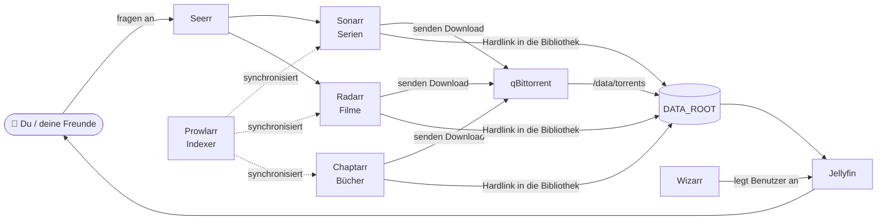

<div align="center">

# 🎬 Jellyfin + *arr Stack

**Dein eigenes Netflix zu Hause: Serien, Filme, Bücher und Hörbücher, alles automatisch und mit einem einzigen `docker compose up`.**


🌍 **Idioma / Language**

[ Español](README.md) · [ English](README.en.md) · [ Français](README.fr.md) · [ Italiano](README.it.md) · [ Português](README.pt.md) · ** Deutsch**

</div>

---

## 🤔 Wofür ist das gut?

Stell dir vor, du hättest **dein eigenes Netflix** – aber bei dir zu Hause, ohne Abo und mit allem, was du sehen willst.

Genau das ist dieser Stack: eine Sammlung von Apps, die zusammenarbeiten, sodass du nur noch **aussuchen musst, was du sehen willst**. Um den Rest kümmern sie sich:

- 🔎 Sie **suchen**, was du dir wünschst.
- ⬇️ Sie **laden es herunter** und sagen dir Bescheid.
- 🗂️ Sie **sortieren es** in Ordner, mit Cover und Inhaltsangabe.
- 📺 Sie **stellen es in Jellyfin bereit** – zum Anschauen auf dem Fernseher, dem Handy oder dem Computer, zu Hause oder unterwegs.
- 🔁 Sie **behalten alles im Blick**: Erscheint eine neue Folge deiner Serie, taucht sie von selbst auf, ohne dass du etwas tun musst.

**Ein Beispiel:** Auf dem Handy wünschst du dir in Seerr *„die neue Staffel meiner Lieblingsserie“*. Sonarr findet sie, qBittorrent lädt sie herunter, und kurz darauf ist sie samt Cover in Jellyfin. Und jede Woche, wenn eine neue Folge erscheint, taucht sie von allein auf.

**Ist das was für mich?** Wenn du ein NAS oder einen Rechner hast, der immer läuft, und Lust hast, dir dein eigenes Mediacenter einzurichten: ja. Du musst kein Profi sein – diese Anleitung geht Schritt für Schritt vor.

---

## 📚 Inhaltsverzeichnis

1. [Was dabei ist](#-was-dabei-ist)
2. [So greift alles ineinander](#-so-greift-alles-ineinander)
3. [Voraussetzungen](#-voraussetzungen)
4. [Schritt 1 · Repo herunterladen](#schritt-1--repo-herunterladen)
5. [Schritt 2 · `.env` konfigurieren](#schritt-2--env-konfigurieren)
6. [Schritt 3 · Ordner anlegen und starten](#schritt-3--ordner-anlegen-und-starten)
7. [Schritt 4 · qBittorrent](#schritt-4--qbittorrent)
8. [Schritt 5 · Prowlarr (Indexer)](#schritt-5--prowlarr-indexer)
9. [Schritt 6 · Sonarr und Radarr](#schritt-6--sonarr-und-radarr)
10. [Schritt 7 · Chaptarr (Bücher und Hörbücher)](#schritt-7--chaptarr-bücher-und-hörbücher)
11. [Schritt 8 · Jellyfin](#schritt-8--jellyfin)
12. [Schritt 9 · Seerr (Anfragen)](#schritt-9--seerr-anfragen)
13. [Schritt 10 · Wizarr (Einladungen)](#schritt-10--wizarr-einladungen)
14. [Wartung](#-wartung)
15. [Häufige Probleme](#-häufige-probleme)

---

## 📦 Was dabei ist

| App | Wofür sie gut ist | Port |
|---|---|---|
| **[Jellyfin](https://jellyfin.org)** | Der Medienserver: dort schaust du alles, auf dem Fernseher, dem Handy oder im Browser | `8096` |
| **[qBittorrent](https://www.qbittorrent.org)** | Download-Client | `8085` |
| **[Prowlarr](https://prowlarr.com)** | Verwaltet die Indexer an einer zentralen Stelle und verteilt sie an die übrigen Apps | `9696` |
| **[Sonarr](https://sonarr.tv)** | Serien: überwacht neue Episoden, lädt sie herunter und sortiert sie ein | `8989` |
| **[Radarr](https://radarr.video)** | Dasselbe wie Sonarr, nur für Filme | `7878` |
| **[Chaptarr](https://hub.docker.com/r/chaptarr/chaptarr)** | Bücher und Hörbücher (Ersatz für Readarr, in der Beta), mit Postgres | `8789` |
| **[Seerr](https://github.com/seerr-team/seerr)** | Hübsche Weboberfläche, über die du oder deine Freunde Serien und Filme anfragen könnt | `5055` |
| **[Wizarr](https://github.com/wizarrrr/wizarr)** | Einladungslinks, um Jellyfin-Benutzer anzulegen | `5690` |

---

## 🧭 So greift alles ineinander



**Der Kern des Designs:** Alle Apps sehen denselben Ordner als `/data`. Wenn ein Download fertig ist, legen Sonarr/Radarr/Chaptarr daher einen **Hardlink** in der Bibliothek an: Die Datei taucht an zwei Orten auf, **belegt den Speicherplatz aber nur einmal**, und qBittorrent kann sie weiter seeden, ohne dass du irgendetwas verschieben musst.

```text
DATA_ROOT/                 (in den Containern: /data)
├── torrents/              ← qBittorrent lädt hier herunter
│   ├── series/
│   ├── peliculas/
│   ├── libros/
│   └── audiolibros/
├── Series/                ← Sonarr-Bibliothek
├── Peliculas/             ← Radarr-Bibliothek
├── Libros/                ← Chaptarr-Bibliothek (E-Books)
└── Audiolibros/           ← Chaptarr-Bibliothek (Hörbücher)
```

> [!IMPORTANT]
> `torrents/` und die Bibliotheken müssen **auf demselben Volume bzw. derselben Festplatte** liegen. Hardlinks funktionieren nicht über verschiedene Laufwerke hinweg: Wenn du sie trennst, belegt jede Datei doppelt so viel Platz.

---

## ✅ Voraussetzungen

- Ein Linux-Rechner oder ein NAS (Synology, Unraid, TrueNAS…) mit **Docker** und **Docker Compose v2**.
  - Auf Synology: Installiere den **Container Manager** aus dem Paket-Zentrum.
- Zugriff per **SSH** (oder ein Terminal).
- Optional: Intel-CPU mit integrierter Grafik (Quick Sync) oder AMD, um in Jellyfin per Hardware zu transkodieren.
- Empfohlen: **4 GB RAM** oder mehr. Chaptarr mit Postgres verbraucht beim ersten Scan ziemlich viel.

Prüfe, ob Docker funktioniert:

```bash
docker compose version
```

---

## Schritt 1 · Repo herunterladen

```bash
git clone https://github.com/Luprintech/jellyfin-arr-stack.git
cd jellyfin-arr-stack
```

## Schritt 2 · `.env` konfigurieren

```bash
cp .env.example .env
nano .env
```

Das Minimum, das du anpassen musst:

| Variable | Was eintragen | Wie du es herausfindest |
|---|---|---|
| `PUID` / `PGID` | Der Benutzer, dem deine Medien gehören | `id dein_benutzer` |
| `TZ` | Deine Zeitzone | z. B. `Europe/Madrid` oder `Europe/Paris` |
| `CONFIG_ROOT` | Wo die Konfigurationen gespeichert werden | z. B. `/volume1/docker/media-stack/config` |
| `DATA_ROOT` | Der eine gemeinsame Ordner für Medien und Downloads | z. B. `/volume1/media` |
| `RENDER_GID` | Gruppe der Grafikeinheit (nur für die Hardware-Beschleunigung) | `stat -c '%g' /dev/dri/renderD128` |
| `CHAPTARR_DB_PASSWORD` | Passwort für Postgres | `openssl rand -hex 24` |

> [!TIP]
> **Auf Synology** hat der normale Benutzer meist eine `PUID` um die `1026`, und die Gruppe `users` ist `PGID=100`. Die Gruppe der Grafikeinheit heißt `videodriver`.

## Schritt 3 · Ordner anlegen und starten

```bash
chmod +x scripts/setup.sh
./scripts/setup.sh
docker compose up -d
```

Das Skript **legt** nur fehlende Ordner **an**; es löscht oder überschreibt nichts. Prüfe, ob alles läuft:

```bash
docker compose ps
```

Alle Dienste sollten als `running` angezeigt werden (Seerr und chaptarr-db als `healthy`).

> [!NOTE]
> Ersetze ab hier `IP-DEL-SERVIDOR` durch die IP deines Rechners, zum Beispiel `192.168.1.10`.

---

## Schritt 4 · qBittorrent

Öffne `http://IP-DEL-SERVIDOR:8085`.

1. **Anfangspasswort:** Der Benutzer ist `admin`, und das temporäre Passwort steht im Log:
   ```bash
   docker logs qbittorrent 2>&1 | grep -i password
   ```
   Ändere es gleich nach dem Login unter **Extras → Optionen → Web-UI**.
2. **Downloads** → *Standard-Speicherpfad*: `/data/torrents`.
3. **Kategorien** (Rechtsklick auf *Kategorien* im linken Bereich → *Kategorie hinzufügen*):

   | Kategorie | Pfad |
   |---|---|
   | `series` | `/data/torrents/series` |
   | `peliculas` | `/data/torrents/peliculas` |
   | `libros` | `/data/torrents/libros` |
   | `audiolibros` | `/data/torrents/audiolibros` |

4. **Verbindung** → der Listen-Port muss mit `QBIT_TORRENT_PORT` übereinstimmen (standardmäßig `51413`). Öffne ihn in deinem Router, um bessere Geschwindigkeit zu bekommen.

> [!WARNING]
> Verschiebe niemals von Hand Dateien, die qBittorrent gerade teilt: Der Torrent würde kaputtgehen. Wenn du sie an einen anderen Ort legen musst, nutze in qBittorrent *Rechtsklick → Speicherort festlegen*.

## Schritt 5 · Prowlarr (Indexer)

Öffne `http://IP-DEL-SERVIDOR:9696` und lege deinen Benutzer an.

1. **Indexers → Add Indexer:** Füge die Indexer hinzu, die du nutzen willst. Für private brauchst du dein Konto oder deinen API-Key. Wähle mit Bedacht: Du bist selbst dafür verantwortlich, was du herunterlädst.
2. **Settings → Download Clients → + → qBittorrent:**
   - Host: `qbittorrent` · Port: `8085` · Benutzername und Passwort von qBittorrent.
3. **Settings → Apps:** Hier verbindest du Sonarr, Radarr und Chaptarr (in den nächsten Schritten), damit sie die Indexer automatisch erhalten.

> [!TIP]
> Innerhalb von Docker sehen sich die Apps gegenseitig **über ihren Container-Namen** (`sonarr`, `radarr`, `qbittorrent`…). Verwende weder `localhost` noch die Server-IP, um sie miteinander zu verbinden.

## Schritt 6 · Sonarr und Radarr

Beide werden gleich konfiguriert. Sonarr läuft auf `:8989` und Radarr auf `:7878`.

1. Lege beim ersten Aufruf deinen Benutzer an.
2. **Settings → Media Management:**
   - Aktiviere **Show Advanced** (oben).
   - ✅ *Use Hardlinks instead of Copy*.
   - **Root Folders → Add:** `/data/Series` (Sonarr) bzw. `/data/Peliculas` (Radarr).
3. **Settings → Download Clients → + → qBittorrent:**
   - Host `qbittorrent`, Port `8085`, dein Benutzername und Passwort.
   - Category: `series` (Sonarr) bzw. `peliculas` (Radarr).
4. **Settings → General:** Kopiere den **API Key**.
5. Wähle in **Prowlarr → Settings → Apps → +** Sonarr (oder Radarr):
   - Prowlarr Server: `http://prowlarr:9696`
   - Sonarr Server: `http://sonarr:8989` (oder `http://radarr:7878`)
   - API Key: der, den du gerade kopiert hast.
6. Klicke in Prowlarr auf **Sync App Indexers**. Nach ein paar Sekunden siehst du die Indexer in Sonarr/Radarr unter *Settings → Indexers*.

> [!TIP]
> Unter **Settings → Profiles** kannst du die Qualität wählen (1080p, 4K…), und unter **Settings → Metadata/General** die Sprache der Titel.

## Schritt 7 · Chaptarr (Bücher und Hörbücher)

Öffne `http://IP-DEL-SERVIDOR:8789`.

1. **Root Folders:** Füge zwei hinzu:
   - `/data/Libros` → Typ **ebook**
   - `/data/Audiolibros` → Typ **audiobook**
2. **Media Management:** ✅ *Use Hardlinks*.
3. **Download Clients → qBittorrent:** wie bei Sonarr, mit den Kategorien `libros` und `audiolibros`.
4. **Prowlarr → Apps → +:** Wähle den Typ **Readarr** und trage `http://chaptarr:8789` mit dem API-Key von Chaptarr ein.
5. **Autoren:** Füge die hinzu, denen du folgen möchtest, und aktiviere *Monitor*. Chaptarr benachrichtigt dich über ihre Neuerscheinungen.

> [!NOTE]
> Wenn du bereits eine große Bibliothek hast, kann der **erste Scan Stunden dauern** und die CPU voll auslasten. Deshalb haben `chaptarr` und `chaptarr-db` `cpu_shares: 128`: Sie überlassen Jellyfin und qBittorrent die CPU. Lass ihn einfach durchlaufen.

## Schritt 8 · Jellyfin

Öffne `http://IP-DEL-SERVIDOR:8096` und folge dem Assistenten.

1. Lege den Administrator-Benutzer an.
2. **Bibliotheken hinzufügen.** Achtung: Innerhalb von Jellyfin heißt dein `DATA_ROOT` `/media`:

   | Bibliothek | Typ | Ordner |
   |---|---|---|
   | Serien | Serien | `/media/Series` |
   | Filme | Filme | `/media/Peliculas` |
   | Bücher | Bücher | `/media/Libros` |
   | Hörbücher | Bücher | `/media/Audiolibros` |

   ⚠️ Füge **nicht** `/media/torrents` hinzu: Du würdest alles doppelt sehen.
3. Sprache der Metadaten: deine Sprache und dein Land (z. B. *Deutsch* · *Deutschland*).
4. **Hardware-Beschleunigung** (Dashboard → Wiedergabe → Transkodierung):
   - Intel: Wähle **VAAPI** (oder *Intel QuickSync*, wenn dein Kernel modern ist) mit dem Gerät `/dev/dri/renderD128`.
   - Aktiviere die Hardware-Dekodierung für H264, HEVC und VP9 sowie die Hardware-Kodierung.

> [!TIP]
> **Synology mit Kernel 4.4:** QSV scheitert oft mit dem Fehler `-22`. Nimm **VAAPI**: Es funktioniert gut und transkodiert viel schneller als die CPU.

**Empfohlen für bescheidene Rechner** (2 Kerne):
- Lege den *Bibliotheksscan* auf die Nacht (Dashboard → Geplante Aufgaben).
- Deaktiviere die *Echtzeit-Überwachung* bei sehr großen Bibliotheken (Bücher).
- Wenn du das Plugin Intro Skipper nutzt, setze `MaxParallelism = 1`.

**Damit Sonarr/Radarr Jellyfin benachrichtigen**, sobald es etwas Neues gibt:
*Settings → Connect → + → Emby / Jellyfin* · Host `jellyfin` · Port `8096` · API-Key von Jellyfin (*Dashboard → API-Schlüssel*).

## Schritt 9 · Seerr (Anfragen)

Öffne `http://IP-DEL-SERVIDOR:5055`.

1. Wähle **Jellyfin** und melde dich mit deinem Jellyfin-Administratorkonto an:
   - URL: `http://jellyfin:8096`
2. Synchronisiere die Bibliotheken.
3. **Services:** Füge Sonarr (`sonarr`, Port `8989`) und Radarr (`radarr`, Port `7878`) mit ihren API-Keys hinzu und wähle das Qualitätsprofil und den Root-Ordner.

Ab jetzt kann jeder mit einem Jellyfin-Benutzer über Seerr Serien und Filme anfragen, und sie werden von selbst heruntergeladen.

## Schritt 10 · Wizarr (Einladungen)

Öffne `http://IP-DEL-SERVIDOR:5690`.

1. Lege das Administratorkonto an.
2. Verbinde Jellyfin: `http://jellyfin:8096` + API-Key.
3. Erzeuge einen Einladungslink und teile ihn: Dein Freund legt sich seinen Benutzer selbst an, und Wizarr zeigt ihm obendrein, welche Apps er installieren sollte.

> Um Leute von außerhalb deines Zuhauses einzuladen, musst du Wizarr, Seerr und Jellyfin über einen Reverse-Proxy (Nginx Proxy Manager, Caddy, Traefik…) und HTTPS erreichbar machen. Trage deine öffentliche Domain in `WIZARR_APP_URL` ein.

---

## 🔧 Wartung

**Alle Apps aktualisieren:**
```bash
docker compose pull
docker compose up -d
docker image prune -f
```

**Die Logs einer App ansehen:**
```bash
docker compose logs -f sonarr
```

**Backup:** Sichere den kompletten Ordner `CONFIG_ROOT` und deine `.env`. Damit kannst du alles auf einem anderen Rechner wiederherstellen. Sonarr, Radarr und Prowlarr erstellen außerdem automatische Backups unter *System → Backup*.

> [!CAUTION]
> Sichere `chaptarr-db` bei **gestopptem** Container oder nutze `pg_dumpall`. Wenn du den Datenordner von Postgres im laufenden Betrieb kopierst, kann die Kopie beschädigt sein.

---

## 🩺 Häufige Probleme

<details>
<summary><b>Sonarr/Radarr kopieren die Dateien, statt einen Hardlink anzulegen (die Festplatte füllt sich doppelt so schnell)</b></summary>

- `torrents/` und die Bibliothek liegen auf verschiedenen Festplatten oder Volumes. Sie müssen unter demselben `DATA_ROOT` liegen.
- Eine App bindet andere Pfade ein (zum Beispiel `/downloads` und `/tv`). Alle müssen `/data` verwenden.
- Prüfe eine Datei: `ls -li` und achte darauf, dass die Anzahl der Links (die Spalte nach den Berechtigungen) `2` beträgt.
</details>

<details>
<summary><b>"Permission denied" beim Importieren oder Schreiben</b></summary>

`PUID`/`PGID` stimmen nicht mit dem Besitzer von `DATA_ROOT` überein. Prüfe das mit `ls -ln` auf dem Ordner und passe die `.env` an.
</details>

<details>
<summary><b>Seerr startet nicht oder startet in einer Endlosschleife neu</b></summary>

Sein Konfigurationsordner muss der UID 1000 gehören:
```bash
sudo chown -R 1000:1000 "$CONFIG_ROOT/seerr"
```
</details>

<details>
<summary><b>chaptarr-db startet nicht: "could not change permissions of directory"</b></summary>

Der Ordner `chaptarr-db/data` muss `PUID:PGID` gehören und beim ersten Start leer sein. Das Skript `setup.sh` bereitet das vor.
</details>

<details>
<summary><b>Jellyfin transkodiert nicht per Hardware</b></summary>

- Prüfe, ob `/dev/dri/renderD128` auf dem Host existiert.
- `RENDER_GID` muss die Gruppe sein, der dieses Gerät gehört (`stat -c '%g' /dev/dri/renderD128`).
- Probiere VAAPI statt QSV.
</details>

<details>
<summary><b>Viele "Zombie"-Prozesse im System</b></summary>

Das passiert bei Containern, die Unterprozesse starten (Headless-Browser, Skripte…), ohne dass ein Init-Prozess sie aufräumt. Füge diesem Dienst im Compose-File `init: true` hinzu.
</details>

<details>
<summary><b>Die CPU läuft die ganze Zeit auf 100 %</b></summary>

Meistens ist es der erste Scan von Chaptarr oder die Aufgabe für Segmente bzw. Vorschaubilder in Jellyfin. Finde heraus, wer es ist, mit:
```bash
docker stats --no-stream
```
Und warte, bis er fertig ist, oder senke seine Priorität mit `cpu_shares`.
</details>

---

<div align="center">

Gemacht mit ☕ und ganz viel `docker compose logs`. Wenn es dir geholfen hat, lass einen ⭐ da.

</div>
