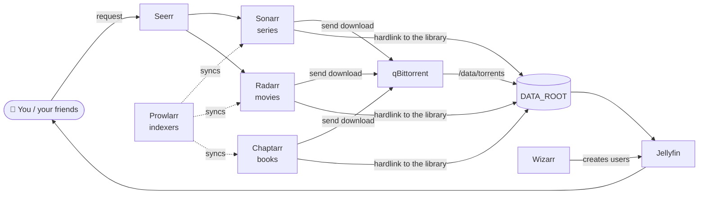

<div align="center">

# 🎬 Jellyfin + *arr Stack

**Your very own Netflix at home: series, movies, books and audiobooks, all automatic and with a single `docker compose up`.**


🌍 **Idioma / Language**

[ Español](README.md) · ** English** · [ Français](README.fr.md) · [ Italiano](README.it.md) · [ Português](README.pt.md) · [ Deutsch](README.de.md)

</div>

---

## 🤔 What is this for?

Imagine having **your own Netflix**, but at home, with no subscriptions and with everything you want to watch.

That's what this stack is: a set of apps that work together so that all you have to do is **choose what you want to watch**. They take care of the rest:

- 🔎 They **search** for whatever you ask for.
- ⬇️ They **download it** and let you know.
- 🗂️ They **organise it** into folders with its poster and synopsis.
- 📺 They **put it in Jellyfin**, ready to watch on your TV, phone or computer, at home or on the go.
- 🔁 They **keep an eye on it**: when a new episode of your show comes out, it just shows up, without you lifting a finger.

**An example:** from your phone, you request *"the new season of my favourite show"* in Seerr. Sonarr finds it, qBittorrent downloads it and, a little later, it's in Jellyfin with its poster. And every week, when a new episode comes out, it will appear on its own.

**Is it for me?** If you have a NAS or a computer that's always on and you fancy building your own media centre, yes. You don't need to be an expert: this guide goes step by step.

---

## 📚 Contents

1. [What's included](#-whats-included)
2. [How it all fits together](#-how-it-all-fits-together)
3. [Requirements](#-requirements)
4. [Step 1 · Download the repo](#step-1--download-the-repo)
5. [Step 2 · Configure the `.env`](#step-2--configure-the-env)
6. [Step 3 · Create folders and start up](#step-3--create-folders-and-start-up)
7. [Step 4 · qBittorrent](#step-4--qbittorrent)
8. [Step 5 · Prowlarr (indexers)](#step-5--prowlarr-indexers)
9. [Step 6 · Sonarr and Radarr](#step-6--sonarr-and-radarr)
10. [Step 7 · Chaptarr (books and audiobooks)](#step-7--chaptarr-books-and-audiobooks)
11. [Step 8 · Jellyfin](#step-8--jellyfin)
12. [Step 9 · Seerr (requests)](#step-9--seerr-requests)
13. [Step 10 · Wizarr (invitations)](#step-10--wizarr-invitations)
14. [Maintenance](#-maintenance)
15. [Common problems](#-common-problems)

---

## 📦 What's included

| App | What it's for | Port |
|---|---|---|
| **[Jellyfin](https://jellyfin.org)** | The media server: where you watch everything, on the TV, your phone or the browser | `8096` |
| **[qBittorrent](https://www.qbittorrent.org)** | Download client | `8085` |
| **[Prowlarr](https://prowlarr.com)** | Manages your indexers in one place and shares them with the rest | `9696` |
| **[Sonarr](https://sonarr.tv)** | Series: watches for new episodes, downloads them and organizes them | `8989` |
| **[Radarr](https://radarr.video)** | The same as Sonarr, but for movies | `7878` |
| **[Chaptarr](https://hub.docker.com/r/chaptarr/chaptarr)** | Books and audiobooks (a Readarr replacement, in beta), with Postgres | `8789` |
| **[Seerr](https://github.com/seerr-team/seerr)** | A nice web UI for you or your friends to request series and movies | `5055` |
| **[Wizarr](https://github.com/wizarrrr/wizarr)** | Invitation links to create Jellyfin users | `5690` |

---

## 🧭 How it all fits together



**The key to the design:** every app sees the same folder as `/data`. That way, when a download finishes, Sonarr/Radarr/Chaptarr create a **hardlink** in the library: the file shows up in two places, **takes up space only once** and qBittorrent can keep seeding it without you moving anything.

```text
DATA_ROOT/                 (in the containers: /data)
├── torrents/              ← qBittorrent downloads here
│   ├── series/
│   ├── peliculas/
│   ├── libros/
│   └── audiolibros/
├── Series/                ← Sonarr library
├── Peliculas/             ← Radarr library
├── Libros/                ← Chaptarr library (ebooks)
└── Audiolibros/           ← Chaptarr library (audiobooks)
```

> [!IMPORTANT]
> `torrents/` and the libraries must be **on the same volume/disk**. Hardlinks don't work across different disks: if you split them up, every file will take up double the space.

---

## ✅ Requirements

- A Linux machine or a NAS (Synology, Unraid, TrueNAS…) with **Docker** and **Docker Compose v2**.
  - On Synology: install **Container Manager** from the Package Center.
- **SSH** access (or a terminal).
- Optional: an Intel CPU with integrated graphics (Quick Sync) or an AMD one for hardware transcoding in Jellyfin.
- Recommended: **4 GB of RAM** or more. Chaptarr with Postgres uses quite a lot during the first scan.

Check that Docker works:

```bash
docker compose version
```

---

## Step 1 · Download the repo

```bash
git clone https://github.com/Luprintech/jellyfin-arr-stack.git
cd jellyfin-arr-stack
```

## Step 2 · Configure the `.env`

```bash
cp .env.example .env
nano .env
```

The bare minimum you need to touch:

| Variable | What to set | How to find out |
|---|---|---|
| `PUID` / `PGID` | The user that owns your media | `id your_user` |
| `TZ` | Your time zone | e.g. `Europe/Madrid`, `Europe/Paris` |
| `CONFIG_ROOT` | Where to store the configs | e.g. `/volume1/docker/media-stack/config` |
| `DATA_ROOT` | The single folder for media and downloads | e.g. `/volume1/media` |
| `RENDER_GID` | Graphics card group (only for hardware acceleration) | `stat -c '%g' /dev/dri/renderD128` |
| `CHAPTARR_DB_PASSWORD` | Postgres password | `openssl rand -hex 24` |

> [!TIP]
> **On Synology**, the regular user usually has a `PUID` around `1026` and the `users` group is `PGID=100`. The graphics card group is called `videodriver`.

## Step 3 · Create folders and start up

```bash
chmod +x scripts/setup.sh
./scripts/setup.sh
docker compose up -d
```

The script only **creates** missing folders; it doesn't delete or overwrite anything. Check that everything is up and running:

```bash
docker compose ps
```

All services should show as `running` (Seerr and chaptarr-db as `healthy`).

> [!NOTE]
> From here on, replace `IP-DEL-SERVIDOR` with your machine's IP, for example `192.168.1.10`.

---

## Step 4 · qBittorrent

Open `http://IP-DEL-SERVIDOR:8085`.

1. **Initial password:** the user is `admin` and the temporary password shows up in the log:
   ```bash
   docker logs qbittorrent 2>&1 | grep -i password
   ```
   Change it as soon as you log in, under **Tools → Options → Web UI**.
2. **Downloads** → *Default Save Path*: `/data/torrents`.
3. **Categories** (right-click on *Categories* in the left panel → *Add category...*):

   | Category | Path |
   |---|---|
   | `series` | `/data/torrents/series` |
   | `peliculas` | `/data/torrents/peliculas` |
   | `libros` | `/data/torrents/libros` |
   | `audiolibros` | `/data/torrents/audiolibros` |

4. **Connection** → the listening port has to match `QBIT_TORRENT_PORT` (`51413` by default). Open it on your router for better speeds.

> [!WARNING]
> Never manually move files that qBittorrent is seeding: it would break the torrent. If you need to relocate them, use *right-click → Set location...* in qBittorrent.

## Step 5 · Prowlarr (indexers)

Open `http://IP-DEL-SERVIDOR:9696` and create your user.

1. **Indexers → Add Indexer:** add the indexers you want to use. For private ones you'll need your account or your API key. Choose wisely: you're responsible for what you download.
2. **Settings → Download Clients → + → qBittorrent:**
   - Host: `qbittorrent` · Port: `8085` · your qBittorrent username and password.
3. **Settings → Apps:** this is where you'll connect Sonarr, Radarr and Chaptarr (in the next steps) so they receive the indexers automatically.

> [!TIP]
> Inside Docker, the apps see each other **by container name** (`sonarr`, `radarr`, `qbittorrent`…). Don't use `localhost` or the server's IP to connect them to each other.

## Step 6 · Sonarr and Radarr

Both are set up the same way. Sonarr is on `:8989` and Radarr on `:7878`.

1. Create your user the first time you open it.
2. **Settings → Media Management:**
   - Turn on **Show Advanced** (at the top).
   - ✅ *Use Hardlinks instead of Copy*.
   - **Root Folders → Add:** `/data/Series` (Sonarr) or `/data/Peliculas` (Radarr).
3. **Settings → Download Clients → + → qBittorrent:**
   - Host `qbittorrent`, Port `8085`, your username and password.
   - Category: `series` (Sonarr) or `peliculas` (Radarr).
4. **Settings → General:** copy the **API Key**.
5. In **Prowlarr → Settings → Apps → +**, pick Sonarr (or Radarr):
   - Prowlarr Server: `http://prowlarr:9696`
   - Sonarr Server: `http://sonarr:8989` (or `http://radarr:7878`)
   - API Key: the one you just copied.
6. Click **Sync App Indexers** in Prowlarr. In a few seconds you'll see the indexers under *Settings → Indexers* in Sonarr/Radarr.

> [!TIP]
> In **Settings → Profiles** you can choose the quality (1080p, 4K…), and in **Settings → Metadata/General**, the language of the titles.

## Step 7 · Chaptarr (books and audiobooks)

Open `http://IP-DEL-SERVIDOR:8789`.

1. **Root Folders:** add two:
   - `/data/Libros` → type **ebook**
   - `/data/Audiolibros` → type **audiobook**
2. **Media Management:** ✅ *Use Hardlinks*.
3. **Download Clients → qBittorrent:** same as in Sonarr, with the `libros` and `audiolibros` categories.
4. **Prowlarr → Apps → +:** pick the **Readarr** type and enter `http://chaptarr:8789` with Chaptarr's API key.
5. **Authors:** add the ones you want to follow and turn on *Monitor*. Chaptarr will let you know about their new releases.

> [!NOTE]
> If you already have a big library, the **first scan can take hours** and keep the CPU at 100%. That's why `chaptarr` and `chaptarr-db` have `cpu_shares: 128`: they yield CPU to Jellyfin and qBittorrent. Let it finish.

## Step 8 · Jellyfin

Open `http://IP-DEL-SERVIDOR:8096` and follow the wizard.

1. Create the administrator user.
2. **Add libraries.** Careful: inside Jellyfin, your `DATA_ROOT` is called `/media`:

   | Library | Type | Folder |
   |---|---|---|
   | Series | Shows | `/media/Series` |
   | Películas | Movies | `/media/Peliculas` |
   | Libros | Books | `/media/Libros` |
   | Audiolibros | Books | `/media/Audiolibros` |

   ⚠️ Do **not** add `/media/torrents`: you'd see everything duplicated.
3. Metadata language: your language and your country.
4. **Hardware acceleration** (Dashboard → Playback → Transcoding):
   - Intel: choose **VAAPI** (or *Intel QuickSync* if your kernel is modern) with the `/dev/dri/renderD128` device.
   - Enable decoding for H264, HEVC and VP9, and hardware encoding.

> [!TIP]
> **Synology with kernel 4.4:** QSV often fails with error `-22`. Use **VAAPI**: it works well and transcodes far faster than the CPU.

**Recommended on modest machines** (2 cores):
- Schedule the *library scan* for the small hours (Dashboard → Scheduled Tasks).
- Turn off *real-time monitoring* on very large libraries (books).
- If you use the Intro Skipper plugin, set `MaxParallelism = 1`.

**To have Sonarr/Radarr notify Jellyfin** when there's something new:
*Settings → Connect → + → Emby / Jellyfin* · Host `jellyfin` · Port `8096` · Jellyfin API key (*Dashboard → API Keys*).

## Step 9 · Seerr (requests)

Open `http://IP-DEL-SERVIDOR:5055`.

1. Choose **Jellyfin** and sign in with your Jellyfin administrator account:
   - URL: `http://jellyfin:8096`
2. Sync the libraries.
3. **Services:** add Sonarr (`sonarr`, port `8989`) and Radarr (`radarr`, port `7878`) with their API keys, and choose the quality profile and the root folder.

From here on, anyone with a Jellyfin user can request series and movies from Seerr, and they download on their own.

## Step 10 · Wizarr (invitations)

Open `http://IP-DEL-SERVIDOR:5690`.

1. Create the administrator account.
2. Connect Jellyfin: `http://jellyfin:8096` + API key.
3. Generate an invitation link and share it: your friend creates their own user and, on top of that, Wizarr shows them which apps to install.

> To invite people from outside your home you'll need to expose Wizarr, Seerr and Jellyfin through a reverse proxy (Nginx Proxy Manager, Caddy, Traefik…) with HTTPS. Put your public domain in `WIZARR_APP_URL`.

---

## 🔧 Maintenance

**Update all the apps:**
```bash
docker compose pull
docker compose up -d
docker image prune -f
```

**See an app's logs:**
```bash
docker compose logs -f sonarr
```

**Backup:** save the whole `CONFIG_ROOT` folder and your `.env`. With that you can rebuild everything on another machine. Sonarr, Radarr and Prowlarr also make automatic backups under *System → Backup*.

> [!CAUTION]
> Back up `chaptarr-db` with the container **stopped**, or use `pg_dumpall`. Copying Postgres' data folder while it's running can leave you with a corrupt backup.

---

## 🩺 Common problems

<details>
<summary><b>Sonarr/Radarr copy the files instead of hardlinking (the disk fills up twice as fast)</b></summary>

- `torrents/` and the library are on different disks or volumes. They have to be under the same `DATA_ROOT`.
- Some app mounts different paths (for example `/downloads` and `/tv`). They all have to use `/data`.
- Check a file: run `ls -li` and make sure the link count (the column after the permissions) is `2`.
</details>

<details>
<summary><b>"Permission denied" when importing or writing</b></summary>

`PUID`/`PGID` don't match the owner of `DATA_ROOT`. Check it with `ls -ln` on the folder and adjust the `.env`.
</details>

<details>
<summary><b>Seerr won't start or keeps restarting in a loop</b></summary>

Its config folder has to be owned by uid 1000:
```bash
sudo chown -R 1000:1000 "$CONFIG_ROOT/seerr"
```
</details>

<details>
<summary><b>chaptarr-db won't start: "could not change permissions of directory"</b></summary>

The `chaptarr-db/data` folder has to be owned by `PUID:PGID` and be empty on first start. The `setup.sh` script leaves it ready.
</details>

<details>
<summary><b>Jellyfin doesn't transcode with hardware</b></summary>

- Check that `/dev/dri/renderD128` exists on the host.
- `RENDER_GID` has to be the group that owns that device (`stat -c '%g' /dev/dri/renderD128`).
- Try VAAPI instead of QSV.
</details>

<details>
<summary><b>Lots of "zombie" processes on the system</b></summary>

It happens with containers that launch subprocesses (headless browsers, scripts…) without an init to reap them. Add `init: true` to that service in the compose file.
</details>

<details>
<summary><b>The CPU is at 100% all the time</b></summary>

Most likely it's Chaptarr's first scan or Jellyfin's segment or thumbnail task. See which one it is with:
```bash
docker stats --no-stream
```
And wait for it to finish, or lower its priority with `cpu_shares`.
</details>

---

<div align="center">

Made with ☕ and a lot of `docker compose logs`. If it helped you, leave a ⭐.

</div>
