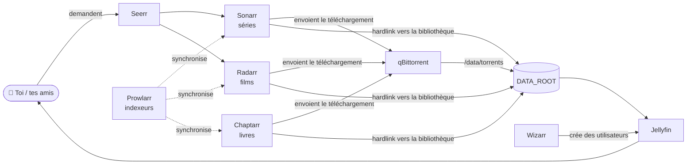

<div align="center">

# 🎬 Jellyfin + *arr Stack

**Ton propre Netflix à la maison : séries, films, livres et livres audio, tout en automatique et avec un seul `docker compose up`.**


🌍 **Idioma / Language**

[ Español](README.md) · [ English](README.en.md) · ** Français** · [ Italiano](README.it.md) · [ Português](README.pt.md) · [ Deutsch](README.de.md)

</div>

---

## 🤔 À quoi ça sert ?

Imagine avoir **ton propre Netflix**, mais chez toi, sans abonnement et avec tout ce que tu veux regarder.

C'est exactement ça, ce stack : un ensemble d'applications qui travaillent ensemble pour que tu n'aies qu'à **choisir ce que tu veux regarder**. Elles s'occupent du reste :

- 🔎 Elles **cherchent** ce que tu demandes.
- ⬇️ Elles **le téléchargent** et te préviennent.
- 🗂️ Elles **le rangent** dans des dossiers avec son affiche et son synopsis.
- 📺 Elles **le mettent dans Jellyfin**, prêt à être regardé sur la télé, le téléphone ou l'ordinateur, chez toi ou à l'extérieur.
- 🔁 Elles **surveillent** : quand un nouvel épisode de ta série sort, il apparaît tout seul, sans que tu fasses quoi que ce soit.

**Un exemple :** depuis ton téléphone, tu demandes *« la nouvelle saison de ma série préférée »* dans Seerr. Sonarr la trouve, qBittorrent la télécharge et, peu après, elle est dans Jellyfin avec son affiche. Et chaque semaine, quand un nouvel épisode sortira, il apparaîtra tout seul.

**C'est pour moi ?** Si tu as un NAS ou un ordinateur toujours allumé et que tu as envie de monter ton propre centre multimédia, oui. Pas besoin d'être expert : ce guide avance pas à pas.

---

## 📚 Sommaire

1. [Contenu](#-contenu)
2. [Comment tout fonctionne ensemble](#-comment-tout-fonctionne-ensemble)
3. [Prérequis](#-prérequis)
4. [Étape 1 · Télécharger le dépôt](#étape-1--télécharger-le-dépôt)
5. [Étape 2 · Configurer le `.env`](#étape-2--configurer-le-env)
6. [Étape 3 · Créer les dossiers et démarrer](#étape-3--créer-les-dossiers-et-démarrer)
7. [Étape 4 · qBittorrent](#étape-4--qbittorrent)
8. [Étape 5 · Prowlarr (indexeurs)](#étape-5--prowlarr-indexeurs)
9. [Étape 6 · Sonarr et Radarr](#étape-6--sonarr-et-radarr)
10. [Étape 7 · Chaptarr (livres et livres audio)](#étape-7--chaptarr-livres-et-livres-audio)
11. [Étape 8 · Jellyfin](#étape-8--jellyfin)
12. [Étape 9 · Seerr (demandes)](#étape-9--seerr-demandes)
13. [Étape 10 · Wizarr (invitations)](#étape-10--wizarr-invitations)
14. [Maintenance](#-maintenance)
15. [Problèmes fréquents](#-problèmes-fréquents)

---

## 📦 Contenu

| App | À quoi ça sert | Port |
|---|---|---|
| **[Jellyfin](https://jellyfin.org)** | Le serveur multimédia : là où tu regardes tout, sur la télé, le mobile ou le navigateur | `8096` |
| **[qBittorrent](https://www.qbittorrent.org)** | Client de téléchargement | `8085` |
| **[Prowlarr](https://prowlarr.com)** | Gère les indexeurs au même endroit et les distribue aux autres apps | `9696` |
| **[Sonarr](https://sonarr.tv)** | Séries : surveille les nouveaux épisodes, les télécharge et les range | `8989` |
| **[Radarr](https://radarr.video)** | Pareil que Sonarr, mais pour les films | `7878` |
| **[Chaptarr](https://hub.docker.com/r/chaptarr/chaptarr)** | Livres et livres audio (remplaçant de Readarr, en bêta), avec Postgres | `8789` |
| **[Seerr](https://github.com/seerr-team/seerr)** | Une jolie interface web pour que toi ou tes amis puissiez demander des séries et des films | `5055` |
| **[Wizarr](https://github.com/wizarrrr/wizarr)** | Liens d'invitation pour créer des utilisateurs Jellyfin | `5690` |

---

## 🧭 Comment tout fonctionne ensemble



**La clé de la conception :** toutes les apps voient le même dossier comme `/data`. Ainsi, quand un téléchargement se termine, Sonarr/Radarr/Chaptarr créent un **hardlink** dans la bibliothèque : le fichier apparaît à deux endroits, **il n'occupe la place qu'une seule fois** et qBittorrent peut continuer à le partager sans que tu aies à déplacer quoi que ce soit.

```text
DATA_ROOT/                 (en los contenedores: /data)
├── torrents/              ← qBittorrent télécharge ici
│   ├── series/
│   ├── peliculas/
│   ├── libros/
│   └── audiolibros/
├── Series/                ← bibliothèque de Sonarr
├── Peliculas/             ← bibliothèque de Radarr
├── Libros/                ← bibliothèque de Chaptarr (ebooks)
└── Audiolibros/           ← bibliothèque de Chaptarr (livres audio)
```

> [!IMPORTANT]
> `torrents/` et les bibliothèques doivent être **sur le même volume/disque**. Les hardlinks ne fonctionnent pas entre des disques différents : si tu les sépares, chaque fichier occupera le double de place.

---

## ✅ Prérequis

- Une machine Linux ou un NAS (Synology, Unraid, TrueNAS…) avec **Docker** et **Docker Compose v2**.
  - Sur Synology : installe **Container Manager** depuis le Centre de paquets.
- Un accès par **SSH** (ou un terminal).
- Optionnel : un CPU Intel avec carte graphique intégrée (Quick Sync) ou AMD pour le transcodage matériel dans Jellyfin.
- Recommandé : **4 Go de RAM** ou plus. Chaptarr avec Postgres consomme pas mal de ressources pendant le premier scan.

Vérifie que Docker fonctionne :

```bash
docker compose version
```

---

## Étape 1 · Télécharger le dépôt

```bash
git clone https://github.com/Luprintech/jellyfin-arr-stack.git
cd jellyfin-arr-stack
```

## Étape 2 · Configurer le `.env`

```bash
cp .env.example .env
nano .env
```

Le minimum à modifier :

| Variable | Quoi mettre | Comment le trouver |
|---|---|---|
| `PUID` / `PGID` | L'utilisateur propriétaire de tes médias | `id ton_utilisateur` |
| `TZ` | Ton fuseau horaire | p. ex. `Europe/Madrid`, `Europe/Paris` |
| `CONFIG_ROOT` | Où stocker les configurations | p. ex. `/volume1/docker/media-stack/config` |
| `DATA_ROOT` | Le dossier unique des médias et des téléchargements | p. ex. `/volume1/media` |
| `RENDER_GID` | Groupe de la carte graphique (uniquement pour l'accélération matérielle) | `stat -c '%g' /dev/dri/renderD128` |
| `CHAPTARR_DB_PASSWORD` | Mot de passe de Postgres | `openssl rand -hex 24` |

> [!TIP]
> **Sur Synology**, l'utilisateur normal a généralement un `PUID` autour de `1026` et le groupe `users` correspond à `PGID=100`. Le groupe de la carte graphique s'appelle `videodriver`.

## Étape 3 · Créer les dossiers et démarrer

```bash
chmod +x scripts/setup.sh
./scripts/setup.sh
docker compose up -d
```

Le script ne fait que **créer** les dossiers manquants ; il ne supprime ni n'écrase rien. Vérifie que tout tourne :

```bash
docker compose ps
```

Tous les services devraient apparaître comme `running` (Seerr et chaptarr-db comme `healthy`).

Tous les conteneurs sont créés dans **un seul projet nommé `jellyfin-arr-stack`** : tu les verras regroupés dans Portainer, dans Container Manager ou avec `docker compose ls`.

> [!TIP]
> **Tu préfères passer par l'interface de Synology ?** Lance d'abord `./scripts/setup.sh` en SSH, puis va dans **Container Manager → Projet → Créer** :
> 1. Nom du projet : `jellyfin-arr-stack`.
> 2. Chemin : le dossier où tu as cloné le dépôt (celui qui contient `docker-compose.yml` et `.env`).
> 3. Source : *Utiliser le docker-compose.yml existant* → **Suivant** → **Terminé**.
>
> De là, tu pourras démarrer, arrêter, mettre à jour et consulter les logs de tout le stack en un clic.

> [!NOTE]
> À partir d'ici, remplace `IP-DEL-SERVIDOR` par l'IP de ta machine, par exemple `192.168.1.10`.

---

## Étape 4 · qBittorrent

Ouvre `http://IP-DEL-SERVIDOR:8085`.

1. **Mot de passe initial :** l'utilisateur est `admin` et le mot de passe temporaire apparaît dans le log :
   ```bash
   docker logs qbittorrent 2>&1 | grep -i password
   ```
   Change-le dès ton arrivée dans **Outils → Options → Interface Web**.
2. **Téléchargements** → *Chemin de sauvegarde par défaut* : `/data/torrents`.
3. **Catégories** (clic droit sur *Catégories*, dans le panneau de gauche → *Ajouter une catégorie*) :

   | Catégorie | Chemin |
   |---|---|
   | `series` | `/data/torrents/series` |
   | `peliculas` | `/data/torrents/peliculas` |
   | `libros` | `/data/torrents/libros` |
   | `audiolibros` | `/data/torrents/audiolibros` |

4. **Connexion** → le port d'écoute doit correspondre à `QBIT_TORRENT_PORT` (par défaut `51413`). Ouvre-le sur ton routeur pour avoir une meilleure vitesse.

> [!WARNING]
> Ne déplace jamais à la main des fichiers que qBittorrent est en train de partager : tu casserais le torrent. Si tu dois les changer de place, utilise dans qBittorrent *clic droit → Définir l'emplacement*.

## Étape 5 · Prowlarr (indexeurs)

Ouvre `http://IP-DEL-SERVIDOR:9696` et crée ton utilisateur.

1. **Indexers → Add Indexer :** ajoute les indexeurs que tu veux utiliser. Pour les privés, tu auras besoin de ton compte ou de ta clé API. Choisis avec discernement : tu es responsable de ce que tu télécharges.
2. **Settings → Download Clients → + → qBittorrent :**
   - Host : `qbittorrent` · Port : `8085` · utilisateur et mot de passe de qBittorrent.
3. **Settings → Apps :** c'est ici que tu connecteras Sonarr, Radarr et Chaptarr (dans les étapes suivantes) pour qu'ils reçoivent les indexeurs automatiquement.

> [!TIP]
> Dans Docker, les apps se voient entre elles **par leur nom de conteneur** (`sonarr`, `radarr`, `qbittorrent`…). N'utilise ni `localhost` ni l'IP du serveur pour les connecter entre elles.

## Étape 6 · Sonarr et Radarr

Les deux se configurent de la même façon. Sonarr est sur `:8989` et Radarr sur `:7878`.

1. Crée ton utilisateur à la première connexion.
2. **Settings → Media Management :**
   - Active **Show Advanced** (en haut).
   - ✅ *Use Hardlinks instead of Copy*.
   - **Root Folders → Add :** `/data/Series` (Sonarr) ou `/data/Peliculas` (Radarr).
3. **Settings → Download Clients → + → qBittorrent :**
   - Host `qbittorrent`, Port `8085`, ton utilisateur et ton mot de passe.
   - Category : `series` (Sonarr) ou `peliculas` (Radarr).
4. **Settings → General :** copie l'**API Key**.
5. Dans **Prowlarr → Settings → Apps → +**, choisis Sonarr (ou Radarr) :
   - Prowlarr Server : `http://prowlarr:9696`
   - Sonarr Server : `http://sonarr:8989` (ou `http://radarr:7878`)
   - API Key : celle que tu viens de copier.
6. Clique sur **Sync App Indexers** dans Prowlarr. En quelques secondes, tu verras les indexeurs dans *Settings → Indexers* de Sonarr/Radarr.

> [!TIP]
> Dans **Settings → Profiles**, tu peux choisir la qualité (1080p, 4K…), et dans **Settings → Metadata/General**, la langue des titres.

## Étape 7 · Chaptarr (livres et livres audio)

Ouvre `http://IP-DEL-SERVIDOR:8789`.

1. **Root Folders :** ajoutes-en deux :
   - `/data/Libros` → type **ebook**
   - `/data/Audiolibros` → type **audiobook**
2. **Media Management :** ✅ *Use Hardlinks*.
3. **Download Clients → qBittorrent :** comme dans Sonarr, avec les catégories `libros` et `audiolibros`.
4. **Prowlarr → Apps → + :** choisis le type **Readarr** et indique `http://chaptarr:8789` avec la clé API de Chaptarr.
5. **Auteurs :** ajoute ceux que tu veux suivre et active *Monitor*. Chaptarr t'avertira de leurs nouveautés.

> [!NOTE]
> Si tu as déjà une grosse bibliothèque, le **premier scan peut durer des heures** et faire monter le CPU à 100 %. C'est pour ça que `chaptarr` et `chaptarr-db` ont `cpu_shares: 128` : ils cèdent le CPU à Jellyfin et qBittorrent. Laisse-le finir.

## Étape 8 · Jellyfin

Ouvre `http://IP-DEL-SERVIDOR:8096` et suis l'assistant.

1. Crée l'utilisateur administrateur.
2. **Ajouter des bibliothèques.** Attention : dans Jellyfin, ton `DATA_ROOT` s'appelle `/media` :

   | Bibliothèque | Type | Dossier |
   |---|---|---|
   | Séries | Séries | `/media/Series` |
   | Films | Films | `/media/Peliculas` |
   | Livres | Livres | `/media/Libros` |
   | Livres audio | Livres | `/media/Audiolibros` |

   ⚠️ N'ajoute **pas** `/media/torrents` : tu verrais tout en double.
3. Langue des métadonnées : *Français* · Pays : *France*.
4. **Accélération matérielle** (Tableau de bord → Lecture → Transcodage) :
   - Intel : choisis **VAAPI** (ou *Intel QuickSync* si ton kernel est récent) avec le périphérique `/dev/dri/renderD128`.
   - Active le décodage pour H264, HEVC et VP9, ainsi que l'encodage matériel.

> [!TIP]
> **Synology avec kernel 4.4 :** QSV échoue souvent avec l'erreur `-22`. Utilise **VAAPI** : ça marche bien et ça transcode bien plus vite que le CPU.

**Recommandé sur les machines modestes** (2 cœurs) :
- Programme le *scan de la bibliothèque* pour la nuit (Tableau de bord → Tâches planifiées).
- Désactive la *surveillance en temps réel* sur les très grosses bibliothèques (livres).
- Si tu utilises le plugin Intro Skipper, mets-lui `MaxParallelism = 1`.

**Pour que Sonarr/Radarr préviennent Jellyfin** quand il y a du nouveau :
*Settings → Connect → + → Emby / Jellyfin* · Host `jellyfin` · Port `8096` · clé API de Jellyfin (*Tableau de bord → Clés API*).

## Étape 9 · Seerr (demandes)

Ouvre `http://IP-DEL-SERVIDOR:5055`.

1. Choisis **Jellyfin** et connecte-toi avec ton compte administrateur Jellyfin :
   - URL : `http://jellyfin:8096`
2. Synchronise les bibliothèques.
3. **Services :** ajoute Sonarr (`sonarr`, port `8989`) et Radarr (`radarr`, port `7878`) avec leurs clés API, puis choisis le profil de qualité et le dossier racine.

À partir de là, toute personne ayant un utilisateur Jellyfin peut demander des séries et des films depuis Seerr, et ils se téléchargent tout seuls.

## Étape 10 · Wizarr (invitations)

Ouvre `http://IP-DEL-SERVIDOR:5690`.

1. Crée le compte administrateur.
2. Connecte Jellyfin : `http://jellyfin:8096` + clé API.
3. Génère un lien d'invitation et partage-le : ton ami se crée son utilisateur tout seul et, en plus, Wizarr lui montre quelles apps installer.

> Pour inviter des personnes extérieures à ton foyer, tu devras exposer Wizarr, Seerr et Jellyfin avec un reverse proxy (Nginx Proxy Manager, Caddy, Traefik…) et du HTTPS. Mets ton domaine public dans `WIZARR_APP_URL`.

---

## 🔧 Maintenance

**Mettre à jour toutes les apps :**
```bash
docker compose pull
docker compose up -d
docker image prune -f
```

**Voir les logs d'une app :**
```bash
docker compose logs -f sonarr
```

**Sauvegarde :** conserve le dossier `CONFIG_ROOT` en entier et ton `.env`. Avec ça, tu peux tout reconstruire sur une autre machine. Sonarr, Radarr et Prowlarr font aussi des sauvegardes automatiques dans *System → Backup*.

> [!CAUTION]
> Fais la sauvegarde de `chaptarr-db` avec le conteneur **arrêté**, ou utilise `pg_dumpall`. Copier à chaud le dossier de données de Postgres peut produire une copie corrompue.

---

## 🩺 Problèmes fréquents

<details>
<summary><b>Sonarr/Radarr copient les fichiers au lieu de faire un hardlink (le disque se remplit deux fois plus vite)</b></summary>

- `torrents/` et la bibliothèque sont sur des disques ou des volumes différents. Ils doivent se trouver sous le même `DATA_ROOT`.
- Une app monte des chemins différents (par exemple `/downloads` et `/tv`). Toutes doivent utiliser `/data`.
- Vérifie un fichier : `ls -li` et regarde que le nombre de liens (la colonne après les permissions) soit `2`.
</details>

<details>
<summary><b>"Permission denied" à l'import ou à l'écriture</b></summary>

`PUID`/`PGID` ne correspondent pas au propriétaire de `DATA_ROOT`. Vérifie avec `ls -ln` sur le dossier et ajuste le `.env`.
</details>

<details>
<summary><b>Seerr ne démarre pas ou redémarre en boucle</b></summary>

Son dossier de configuration doit appartenir à l'uid 1000 :
```bash
sudo chown -R 1000:1000 "$CONFIG_ROOT/seerr"
```
</details>

<details>
<summary><b>chaptarr-db ne démarre pas : "could not change permissions of directory"</b></summary>

Le dossier `chaptarr-db/data` doit appartenir à `PUID:PGID` et être vide au premier démarrage. Le script `setup.sh` le prépare pour toi.
</details>

<details>
<summary><b>Jellyfin ne transcode pas en matériel</b></summary>

- Vérifie que `/dev/dri/renderD128` existe sur l'hôte.
- `RENDER_GID` doit être le groupe propriétaire de ce périphérique (`stat -c '%g' /dev/dri/renderD128`).
- Essaie VAAPI à la place de QSV.
</details>

<details>
<summary><b>Beaucoup de processus "zombie" dans le système</b></summary>

Ça arrive avec des conteneurs qui lancent des sous-processus (navigateurs headless, scripts…) sans un init pour les récupérer. Ajoute `init: true` à ce service dans le compose.
</details>

<details>
<summary><b>Le CPU est à 100 % en permanence</b></summary>

Le plus souvent, c'est le premier scan de Chaptarr ou la tâche de segments ou de miniatures de Jellyfin. Regarde qui c'est avec :
```bash
docker stats --no-stream
```
Puis attends que ça se termine, ou baisse sa priorité avec `cpu_shares`.
</details>

---

<div align="center">

Fait avec ☕ et beaucoup de `docker compose logs`. Si ça t'a servi, laisse une ⭐.

</div>
