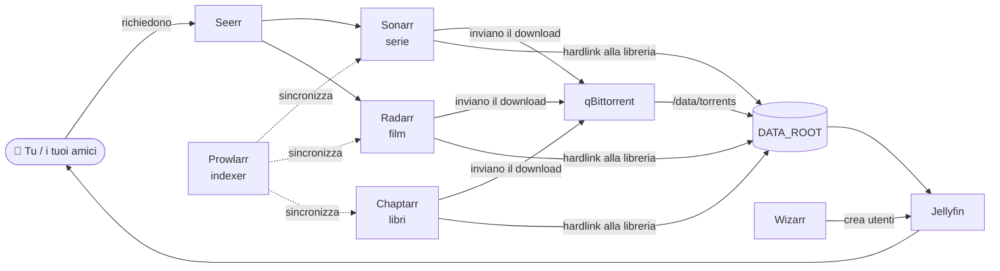

<div align="center">

# 🎬 Jellyfin + *arr Stack

**Il tuo Netflix personale a casa: serie, film, libri e audiolibri, tutto automatico e con un solo `docker compose up`.**


🌍 **Idioma / Language**

[ Español](README.md) · [ English](README.en.md) · [ Français](README.fr.md) · ** Italiano** · [ Português](README.pt.md) · [ Deutsch](README.de.md)

</div>

---

## 📚 Indice

1. [Cosa include](#-cosa-include)
2. [Come si incastra tutto](#-come-si-incastra-tutto)
3. [Requisiti](#-requisiti)
4. [Passo 1 · Scaricare il repo](#passo-1--scaricare-il-repo)
5. [Passo 2 · Configurare il `.env`](#passo-2--configurare-il-env)
6. [Passo 3 · Creare le cartelle e avviare](#passo-3--creare-le-cartelle-e-avviare)
7. [Passo 4 · qBittorrent](#passo-4--qbittorrent)
8. [Passo 5 · Prowlarr (indexer)](#passo-5--prowlarr-indexer)
9. [Passo 6 · Sonarr e Radarr](#passo-6--sonarr-e-radarr)
10. [Passo 7 · Chaptarr (libri e audiolibri)](#passo-7--chaptarr-libri-e-audiolibri)
11. [Passo 8 · Jellyfin](#passo-8--jellyfin)
12. [Passo 9 · Seerr (richieste)](#passo-9--seerr-richieste)
13. [Passo 10 · Wizarr (inviti)](#passo-10--wizarr-inviti)
14. [Manutenzione](#-manutenzione)
15. [Problemi frequenti](#-problemi-frequenti)

---

## 📦 Cosa include

| App | A cosa serve | Porta |
|---|---|---|
| **[Jellyfin](https://jellyfin.org)** | Il server multimediale: dove guardi tutto, sulla TV, sul cellulare o dal browser | `8096` |
| **[qBittorrent](https://www.qbittorrent.org)** | Client di download | `8085` |
| **[Prowlarr](https://prowlarr.com)** | Gestisce gli indexer in un unico posto e li distribuisce alle altre app | `9696` |
| **[Sonarr](https://sonarr.tv)** | Serie: tiene d'occhio i nuovi episodi, li scarica e li organizza | `8989` |
| **[Radarr](https://radarr.video)** | Lo stesso di Sonarr, ma per i film | `7878` |
| **[Chaptarr](https://hub.docker.com/r/chaptarr/chaptarr)** | Libri e audiolibri (sostituto di Readarr, in beta), con Postgres | `8789` |
| **[Seerr](https://github.com/seerr-team/seerr)** | Una bella interfaccia web per far chiedere serie e film a te o ai tuoi amici | `5055` |
| **[Wizarr](https://github.com/wizarrrr/wizarr)** | Link d'invito per creare utenti Jellyfin | `5690` |

---

## 🧭 Come si incastra tutto



**La chiave del progetto:** tutte le app vedono la stessa cartella come `/data`. Così, quando un download finisce, Sonarr/Radarr/Chaptarr creano un **hardlink** nella libreria: il file compare in due posti, **occupa spazio una sola volta** e qBittorrent può continuare a condividerlo senza che tu sposti nulla.

```text
DATA_ROOT/                 (nei container: /data)
├── torrents/              ← qBittorrent scarica qui
│   ├── series/
│   ├── peliculas/
│   ├── libros/
│   └── audiolibros/
├── Series/                ← libreria di Sonarr
├── Peliculas/             ← libreria di Radarr
├── Libros/                ← libreria di Chaptarr (ebook)
└── Audiolibros/           ← libreria di Chaptarr (audiolibri)
```

> [!IMPORTANT]
> `torrents/` e le librerie devono stare **sullo stesso volume/disco**. Gli hardlink non funzionano tra dischi diversi: se li separi, ogni file occuperà il doppio.

---

## ✅ Requisiti

- Un computer Linux o un NAS (Synology, Unraid, TrueNAS…) con **Docker** e **Docker Compose v2**.
  - Su Synology: installa **Container Manager** dal Centro pacchetti.
- Accesso via **SSH** (o un terminale).
- Facoltativo: CPU Intel con grafica integrata (Quick Sync) o AMD per la transcodifica hardware in Jellyfin.
- Consigliato: **4 GB di RAM** o più. Chaptarr con Postgres consuma parecchio durante la prima scansione.

Verifica che Docker funzioni:

```bash
docker compose version
```

---

## Passo 1 · Scaricare il repo

```bash
git clone https://github.com/Luprintech/jellyfin-arr-stack.git
cd jellyfin-arr-stack
```

## Passo 2 · Configurare il `.env`

```bash
cp .env.example .env
nano .env
```

Il minimo che devi modificare:

| Variabile | Cosa inserire | Come scoprirlo |
|---|---|---|
| `PUID` / `PGID` | L'utente proprietario dei tuoi media | `id tuo_utente` |
| `TZ` | Il tuo fuso orario | es. `Europe/Madrid`, `Europe/Paris` |
| `CONFIG_ROOT` | Dove salvare le configurazioni | es. `/volume1/docker/media-stack/config` |
| `DATA_ROOT` | L'unica cartella per media e download | es. `/volume1/media` |
| `RENDER_GID` | Gruppo della scheda grafica (solo per l'accelerazione hardware) | `stat -c '%g' /dev/dri/renderD128` |
| `CHAPTARR_DB_PASSWORD` | Password di Postgres | `openssl rand -hex 24` |

> [!TIP]
> **Su Synology**, l'utente normale di solito ha un `PUID` intorno a `1026` e il gruppo `users` è `PGID=100`. Il gruppo della scheda grafica si chiama `videodriver`.

## Passo 3 · Creare le cartelle e avviare

```bash
chmod +x scripts/setup.sh
./scripts/setup.sh
docker compose up -d
```

Lo script **crea** solo le cartelle mancanti; non cancella né sovrascrive nulla. Controlla che sia tutto in esecuzione:

```bash
docker compose ps
```

Tutti i servizi dovrebbero risultare `running` (Seerr e chaptarr-db come `healthy`).

> [!NOTE]
> Da qui in avanti, sostituisci `IP-DEL-SERVIDOR` con l'IP del tuo computer, per esempio `192.168.1.10`.

---

## Passo 4 · qBittorrent

Apri `http://IP-DEL-SERVIDOR:8085`.

1. **Password iniziale:** l'utente è `admin` e la password temporanea compare nel log:
   ```bash
   docker logs qbittorrent 2>&1 | grep -i password
   ```
   Cambiala appena entri, in **Strumenti → Opzioni → Web UI**.
2. **Download** → *Percorso di salvataggio predefinito*: `/data/torrents`.
3. **Categorie** (clic destro su *Categorie*, nel pannello di sinistra → *Aggiungi categoria*):

   | Categoria | Percorso |
   |---|---|
   | `series` | `/data/torrents/series` |
   | `peliculas` | `/data/torrents/peliculas` |
   | `libros` | `/data/torrents/libros` |
   | `audiolibros` | `/data/torrents/audiolibros` |

4. **Connessione** → la porta di ascolto deve coincidere con `QBIT_TORRENT_PORT` (di default `51413`). Aprila sul tuo router per avere una velocità migliore.

> [!WARNING]
> Non spostare mai a mano file che qBittorrent sta condividendo: il torrent si romperebbe. Se hai bisogno di cambiarne la posizione, in qBittorrent usa *clic destro → Imposta posizione*.

## Passo 5 · Prowlarr (indexer)

Apri `http://IP-DEL-SERVIDOR:9696` e crea il tuo utente.

1. **Indexers → Add Indexer:** aggiungi gli indexer che vuoi usare. Per quelli privati ti serviranno il tuo account o la tua API key. Scegli con giudizio: sei tu il responsabile di ciò che scarichi.
2. **Settings → Download Clients → + → qBittorrent:**
   - Host: `qbittorrent` · Port: `8085` · utente e password di qBittorrent.
3. **Settings → Apps:** qui collegherai Sonarr, Radarr e Chaptarr (nei passi successivi) così riceveranno gli indexer automaticamente.

> [!TIP]
> Dentro Docker, le app si vedono tra loro **tramite il nome del container** (`sonarr`, `radarr`, `qbittorrent`…). Non usare `localhost` né l'IP del server per collegarle tra loro.

## Passo 6 · Sonarr e Radarr

Si configurano allo stesso modo. Sonarr è su `:8989` e Radarr su `:7878`.

1. Crea il tuo utente al primo accesso.
2. **Settings → Media Management:**
   - Attiva **Show Advanced** (in alto).
   - ✅ *Use Hardlinks instead of Copy*.
   - **Root Folders → Add:** `/data/Series` (Sonarr) o `/data/Peliculas` (Radarr).
3. **Settings → Download Clients → + → qBittorrent:**
   - Host `qbittorrent`, Port `8085`, il tuo utente e la tua password.
   - Category: `series` (Sonarr) o `peliculas` (Radarr).
4. **Settings → General:** copia la **API Key**.
5. In **Prowlarr → Settings → Apps → +**, scegli Sonarr (o Radarr):
   - Prowlarr Server: `http://prowlarr:9696`
   - Sonarr Server: `http://sonarr:8989` (o `http://radarr:7878`)
   - API Key: quella che hai appena copiato.
6. Premi **Sync App Indexers** in Prowlarr. In pochi secondi vedrai gli indexer in *Settings → Indexers* di Sonarr/Radarr.

> [!TIP]
> In **Settings → Profiles** puoi scegliere la qualità (1080p, 4K…), e in **Settings → Metadata/General** la lingua dei titoli.

## Passo 7 · Chaptarr (libri e audiolibri)

Apri `http://IP-DEL-SERVIDOR:8789`.

1. **Root Folders:** aggiungine due:
   - `/data/Libros` → tipo **ebook**
   - `/data/Audiolibros` → tipo **audiobook**
2. **Media Management:** ✅ *Use Hardlinks*.
3. **Download Clients → qBittorrent:** come in Sonarr, con le categorie `libros` e `audiolibros`.
4. **Prowlarr → Apps → +:** scegli il tipo **Readarr** e inserisci `http://chaptarr:8789` con la API key di Chaptarr.
5. **Autori:** aggiungi quelli che vuoi seguire e attiva *Monitor*. Chaptarr ti avviserà delle loro novità.

> [!NOTE]
> Se hai già una libreria grande, la **prima scansione può durare ore** e tenere la CPU al 100%. Per questo `chaptarr` e `chaptarr-db` hanno `cpu_shares: 128`: cedono la CPU a Jellyfin e qBittorrent. Lasciala finire.

## Passo 8 · Jellyfin

Apri `http://IP-DEL-SERVIDOR:8096` e segui la procedura guidata.

1. Crea l'utente amministratore.
2. **Aggiungi le librerie.** Attenzione: dentro Jellyfin, il tuo `DATA_ROOT` si chiama `/media`:

   | Libreria | Tipo | Cartella |
   |---|---|---|
   | Serie | Shows | `/media/Series` |
   | Film | Movies | `/media/Peliculas` |
   | Libri | Books | `/media/Libros` |
   | Audiolibri | Books | `/media/Audiolibros` |

   ⚠️ **Non** aggiungere `/media/torrents`: vedresti tutto duplicato.
3. Lingua dei metadati: la tua lingua · Paese: il tuo paese.
4. **Accelerazione hardware** (Dashboard → Playback → Transcoding):
   - Intel: scegli **VAAPI** (o *Intel QuickSync* se il tuo kernel è recente) con il dispositivo `/dev/dri/renderD128`.
   - Attiva la decodifica per H264, HEVC e VP9, e la codifica hardware.

> [!TIP]
> **Synology con kernel 4.4:** QSV spesso fallisce con l'errore `-22`. Usa **VAAPI**: funziona bene e transcodifica molto più velocemente della CPU.

**Consigliato su macchine modeste** (2 core):
- Programma la *scansione della libreria* per la notte (Dashboard → Scheduled Tasks).
- Disattiva il *monitoraggio in tempo reale* nelle librerie molto grandi (libri).
- Se usi il plugin Intro Skipper, imposta `MaxParallelism = 1`.

**Per far sì che Sonarr/Radarr avvisino Jellyfin** quando c'è qualcosa di nuovo:
*Settings → Connect → + → Emby / Jellyfin* · Host `jellyfin` · Port `8096` · API key di Jellyfin (*Dashboard → API Keys*).

## Passo 9 · Seerr (richieste)

Apri `http://IP-DEL-SERVIDOR:5055`.

1. Scegli **Jellyfin** e accedi con il tuo account amministratore di Jellyfin:
   - URL: `http://jellyfin:8096`
2. Sincronizza le librerie.
3. **Services:** aggiungi Sonarr (`sonarr`, porta `8989`) e Radarr (`radarr`, porta `7878`) con le rispettive API key, e scegli il profilo di qualità e la cartella radice.

Da qui in poi, chiunque abbia un utente Jellyfin può richiedere serie e film da Seerr, e si scaricano da soli.

## Passo 10 · Wizarr (inviti)

Apri `http://IP-DEL-SERVIDOR:5690`.

1. Crea l'account amministratore.
2. Collega Jellyfin: `http://jellyfin:8096` + API key.
3. Genera un link d'invito e condividilo: il tuo amico si crea l'utente da solo e, in più, Wizarr gli mostra quali app installare.

> Per invitare persone che non abitano a casa tua dovrai esporre Wizarr, Seerr e Jellyfin con un reverse proxy (Nginx Proxy Manager, Caddy, Traefik…) e HTTPS. Metti il tuo dominio pubblico in `WIZARR_APP_URL`.

---

## 🔧 Manutenzione

**Aggiornare tutte le app:**
```bash
docker compose pull
docker compose up -d
docker image prune -f
```

**Vedere i log di un'app:**
```bash
docker compose logs -f sonarr
```

**Backup:** salva l'intera cartella `CONFIG_ROOT` e il tuo `.env`. Con questo puoi ricostruire tutto su un'altra macchina. Sonarr, Radarr e Prowlarr fanno anche backup automatici in *System → Backup*.

> [!CAUTION]
> Fai il backup di `chaptarr-db` con il container **fermo**, oppure usa `pg_dumpall`. Copiare a caldo la cartella dei dati di Postgres può lasciare la copia corrotta.

---

## 🩺 Problemi frequenti

<details>
<summary><b>Sonarr/Radarr copiano i file invece di fare l'hardlink (il disco si riempie il doppio)</b></summary>

- `torrents/` e la libreria si trovano su dischi o volumi diversi. Devono stare sotto lo stesso `DATA_ROOT`.
- Qualche app monta percorsi diversi (per esempio `/downloads` e `/tv`). Tutte devono usare `/data`.
- Controlla un file: `ls -li` e verifica che il numero di link (la colonna dopo i permessi) sia `2`.
</details>

<details>
<summary><b>"Permission denied" durante l'importazione o la scrittura</b></summary>

`PUID`/`PGID` non coincidono con il proprietario di `DATA_ROOT`. Verificalo con `ls -ln` sulla cartella e correggi il `.env`.
</details>

<details>
<summary><b>Seerr non si avvia o si riavvia in loop</b></summary>

La sua cartella di configurazione deve appartenere all'uid 1000:
```bash
sudo chown -R 1000:1000 "$CONFIG_ROOT/seerr"
```
</details>

<details>
<summary><b>chaptarr-db non si avvia: "could not change permissions of directory"</b></summary>

La cartella `chaptarr-db/data` deve appartenere a `PUID:PGID` ed essere vuota al primo avvio. Lo script `setup.sh` la lascia già pronta.
</details>

<details>
<summary><b>Jellyfin non transcodifica via hardware</b></summary>

- Verifica che `/dev/dri/renderD128` esista sull'host.
- `RENDER_GID` deve essere il gruppo proprietario di quel dispositivo (`stat -c '%g' /dev/dri/renderD128`).
- Prova VAAPI al posto di QSV.
</details>

<details>
<summary><b>Tanti processi "zombie" nel sistema</b></summary>

Succede con i container che lanciano sottoprocessi (browser headless, script…) senza un init che li raccolga. Aggiungi `init: true` a quel servizio nel compose.
</details>

<details>
<summary><b>La CPU è al 100% tutto il tempo</b></summary>

Di solito è la prima scansione di Chaptarr o l'attività dei segmenti o delle miniature di Jellyfin. Scopri chi è con:
```bash
docker stats --no-stream
```
E aspetta che finisca, oppure abbassa la sua priorità con `cpu_shares`.
</details>

---

<div align="center">

Fatto con ☕ e un sacco di `docker compose logs`. Se ti è stato utile, lascia una ⭐.

</div>
