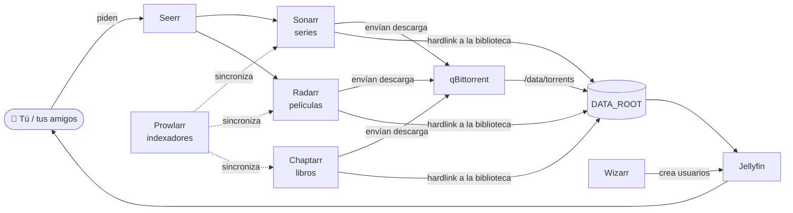

<div align="center">

# 🎬 Jellyfin + *arr Stack

**Tu propio Netflix en casa: series, películas, libros y audiolibros, todo automático y con un solo `docker compose up`.**


🌍 **Idioma / Language**

** Español** · [ English](README.en.md) · [ Français](README.fr.md) · [ Italiano](README.it.md) · [ Português](README.pt.md) · [ Deutsch](README.de.md)

</div>

---

## 🤔 ¿Para qué sirve esto?

Imagina tener **tu propio Netflix**, pero en tu casa, sin cuotas y con todo lo que quieras ver.

Eso es este stack: un conjunto de aplicaciones que trabajan juntas para que tú solo tengas que **elegir qué quieres ver**. Del resto se encargan ellas:

- 🔎 **Buscan** lo que pides.
- ⬇️ **Lo descargan** y te avisan.
- 🗂️ **Lo ordenan** en carpetas con su portada y su sinopsis.
- 📺 **Lo ponen en Jellyfin**, listo para verlo en la tele, el móvil o el ordenador, desde casa o desde fuera.
- 🔁 **Lo vigilan**: cuando sale un capítulo nuevo de tu serie, aparece solo, sin que hagas nada.

**Un ejemplo:** desde el móvil pides *"la nueva temporada de mi serie favorita"* en Seerr. Sonarr la busca, qBittorrent la descarga y, al rato, ya la tienes en Jellyfin con su portada. Y cada semana, cuando salga un capítulo nuevo, aparecerá solo.

**¿Es para mí?** Si tienes un NAS o un ordenador que esté siempre encendido y te apetece montar tu propio centro multimedia, sí. No hace falta ser experto: esta guía va paso a paso.

---

## 📚 Índice

1. [Qué incluye](#-qué-incluye)
2. [Cómo encaja todo](#-cómo-encaja-todo)
3. [Requisitos](#-requisitos)
4. [Paso 1 · Descargar el repo](#paso-1--descargar-el-repo)
5. [Paso 2 · Configurar el `.env`](#paso-2--configurar-el-env)
6. [Paso 3 · Crear carpetas y arrancar](#paso-3--crear-carpetas-y-arrancar)
7. [Paso 4 · qBittorrent](#paso-4--qbittorrent)
8. [Paso 5 · Prowlarr (indexadores)](#paso-5--prowlarr-indexadores)
9. [Paso 6 · Sonarr y Radarr](#paso-6--sonarr-y-radarr)
10. [Paso 7 · Chaptarr (libros y audiolibros)](#paso-7--chaptarr-libros-y-audiolibros)
11. [Paso 8 · Jellyfin](#paso-8--jellyfin)
12. [Paso 9 · Seerr (peticiones)](#paso-9--seerr-peticiones)
13. [Paso 10 · Wizarr (invitaciones)](#paso-10--wizarr-invitaciones)
14. [Mantenimiento](#-mantenimiento)
15. [Problemas frecuentes](#-problemas-frecuentes)

---

## 📦 Qué incluye

| App | Para qué sirve | Puerto |
|---|---|---|
| **[Jellyfin](https://jellyfin.org)** | El servidor multimedia: donde ves todo, en la tele, el móvil o el navegador | `8096` |
| **[qBittorrent](https://www.qbittorrent.org)** | Cliente de descargas | `8085` |
| **[Prowlarr](https://prowlarr.com)** | Gestiona los indexadores en un solo sitio y los reparte al resto | `9696` |
| **[Sonarr](https://sonarr.tv)** | Series: vigila episodios nuevos, los descarga y los ordena | `8989` |
| **[Radarr](https://radarr.video)** | Lo mismo que Sonarr, pero para películas | `7878` |
| **[Chaptarr](https://hub.docker.com/r/chaptarr/chaptarr)** | Libros y audiolibros (sustituto de Readarr, en beta), con Postgres | `8789` |
| **[Seerr](https://github.com/seerr-team/seerr)** | Web bonita para que tú o tus amigos pidáis series y pelis | `5055` |
| **[Wizarr](https://github.com/wizarrrr/wizarr)** | Enlaces de invitación para crear usuarios de Jellyfin | `5690` |

---

## 🧭 Cómo encaja todo



**La clave del diseño:** todas las apps ven la misma carpeta como `/data`. Así, cuando termina una descarga, Sonarr/Radarr/Chaptarr crean un **hardlink** en la biblioteca: el archivo aparece en dos sitios, **ocupa el espacio una sola vez** y qBittorrent puede seguir compartiéndolo sin que tú muevas nada.

```text
DATA_ROOT/                 (en los contenedores: /data)
├── torrents/              ← qBittorrent descarga aquí
│   ├── series/
│   ├── peliculas/
│   ├── libros/
│   └── audiolibros/
├── Series/                ← biblioteca de Sonarr
├── Peliculas/             ← biblioteca de Radarr
├── Libros/                ← biblioteca de Chaptarr (ebooks)
└── Audiolibros/           ← biblioteca de Chaptarr (audiolibros)
```

> [!IMPORTANT]
> `torrents/` y las bibliotecas tienen que estar **en el mismo volumen/disco**. Los hardlinks no funcionan entre discos distintos: si los separas, cada archivo ocupará el doble.

---

## ✅ Requisitos

- Un equipo Linux o un NAS (Synology, Unraid, TrueNAS…) con **Docker** y **Docker Compose v2**.
  - En Synology: instala **Container Manager** desde el Centro de paquetes.
- Acceso por **SSH** (o una terminal).
- Opcional: CPU Intel con gráfica integrada (Quick Sync) o AMD para transcodificar por hardware en Jellyfin.
- Recomendado: **4 GB de RAM** o más. Chaptarr con Postgres consume bastante durante el primer escaneo.

Comprueba que Docker funciona:

```bash
docker compose version
```

---

## Paso 1 · Descargar el repo

```bash
git clone https://github.com/Luprintech/jellyfin-arr-stack.git
cd jellyfin-arr-stack
```

## Paso 2 · Configurar el `.env`

```bash
cp .env.example .env
nano .env
```

Lo mínimo que tienes que tocar:

| Variable | Qué poner | Cómo averiguarlo |
|---|---|---|
| `PUID` / `PGID` | El usuario dueño de tus medios | `id tu_usuario` |
| `TZ` | Tu zona horaria | p. ej. `Europe/Madrid` |
| `CONFIG_ROOT` | Dónde guardar las configuraciones | p. ej. `/volume1/docker/media-stack/config` |
| `DATA_ROOT` | La carpeta única de medios y descargas | p. ej. `/volume1/media` |
| `RENDER_GID` | Grupo de la gráfica (solo para la aceleración por hardware) | `stat -c '%g' /dev/dri/renderD128` |
| `CHAPTARR_DB_PASSWORD` | Contraseña de Postgres | `openssl rand -hex 24` |

> [!TIP]
> **En Synology**, el usuario normal suele tener un `PUID` en torno a `1026` y el grupo `users` es el `PGID=100`. El grupo de la gráfica se llama `videodriver`.

## Paso 3 · Crear carpetas y arrancar

```bash
chmod +x scripts/setup.sh
./scripts/setup.sh
docker compose up -d
```

El script solo **crea** las carpetas que falten; no borra ni sobrescribe nada. Comprueba que todo está en marcha:

```bash
docker compose ps
```

Todos los servicios deberían aparecer como `running` (Seerr y chaptarr-db como `healthy`).

Todos los contenedores se crean dentro de **un único proyecto llamado `jellyfin-arr-stack`**, así que los verás agrupados en Portainer, en Container Manager o con `docker compose ls`.

> [!TIP]
> **¿Prefieres hacerlo desde la interfaz de Synology?** Ejecuta antes `./scripts/setup.sh` por SSH y luego, en **Container Manager → Proyecto → Crear**:
> 1. Nombre del proyecto: `jellyfin-arr-stack`.
> 2. Ruta: la carpeta donde clonaste el repo (la que contiene `docker-compose.yml` y `.env`).
> 3. Origen: *Usar el docker-compose.yml existente* → **Siguiente** → **Hecho**.
>
> Desde ahí podrás arrancar, parar, actualizar y ver los logs de todo el stack con un clic.

> [!NOTE]
> A partir de aquí, sustituye `IP-DEL-SERVIDOR` por la IP de tu equipo, por ejemplo `192.168.1.10`.

---

## Paso 4 · qBittorrent

Abre `http://IP-DEL-SERVIDOR:8085`.

1. **Contraseña inicial:** el usuario es `admin` y la contraseña temporal sale en el log:
   ```bash
   docker logs qbittorrent 2>&1 | grep -i password
   ```
   Cámbiala nada más entrar en **Herramientas → Opciones → Web UI**.
2. **Descargas** → *Ruta de guardado predeterminada*: `/data/torrents`.
3. **Categorías** (clic derecho en *Categorías*, en el panel izquierdo → *Añadir categoría*):

   | Categoría | Ruta |
   |---|---|
   | `series` | `/data/torrents/series` |
   | `peliculas` | `/data/torrents/peliculas` |
   | `libros` | `/data/torrents/libros` |
   | `audiolibros` | `/data/torrents/audiolibros` |

4. **Conexión** → el puerto de escucha tiene que coincidir con `QBIT_TORRENT_PORT` (por defecto `51413`). Ábrelo en tu router para tener mejor velocidad.

> [!WARNING]
> No muevas nunca a mano archivos que qBittorrent está compartiendo: se rompería el torrent. Si necesitas cambiarlos de sitio, usa en qBittorrent *clic derecho → Establecer ubicación*.

## Paso 5 · Prowlarr (indexadores)

Abre `http://IP-DEL-SERVIDOR:9696` y crea tu usuario.

1. **Indexers → Add Indexer:** añade los indexadores que quieras usar. Para los privados necesitarás tu cuenta o tu API key. Elige con cabeza: tú eres el responsable de lo que descargas.
2. **Settings → Download Clients → + → qBittorrent:**
   - Host: `qbittorrent` · Port: `8085` · usuario y contraseña de qBittorrent.
3. **Settings → Apps:** aquí conectarás Sonarr, Radarr y Chaptarr (en los pasos siguientes) para que reciban los indexadores automáticamente.

> [!TIP]
> Dentro de Docker, las apps se ven entre sí **por su nombre de contenedor** (`sonarr`, `radarr`, `qbittorrent`…). No uses `localhost` ni la IP del servidor para conectar unas con otras.

## Paso 6 · Sonarr y Radarr

Los dos se configuran igual. Sonarr está en `:8989` y Radarr en `:7878`.

1. Crea tu usuario al entrar por primera vez.
2. **Settings → Media Management:**
   - Activa **Show Advanced** (arriba).
   - ✅ *Use Hardlinks instead of Copy*.
   - **Root Folders → Add:** `/data/Series` (Sonarr) o `/data/Peliculas` (Radarr).
3. **Settings → Download Clients → + → qBittorrent:**
   - Host `qbittorrent`, Port `8085`, tu usuario y contraseña.
   - Category: `series` (Sonarr) o `peliculas` (Radarr).
4. **Settings → General:** copia la **API Key**.
5. En **Prowlarr → Settings → Apps → +**, elige Sonarr (o Radarr):
   - Prowlarr Server: `http://prowlarr:9696`
   - Sonarr Server: `http://sonarr:8989` (o `http://radarr:7878`)
   - API Key: la que acabas de copiar.
6. Pulsa **Sync App Indexers** en Prowlarr. En unos segundos verás los indexadores en *Settings → Indexers* de Sonarr/Radarr.

> [!TIP]
> En **Settings → Profiles** puedes elegir la calidad (1080p, 4K…), y en **Settings → Metadata/General**, el idioma de los títulos.

## Paso 7 · Chaptarr (libros y audiolibros)

Abre `http://IP-DEL-SERVIDOR:8789`.

1. **Root Folders:** añade dos:
   - `/data/Libros` → tipo **ebook**
   - `/data/Audiolibros` → tipo **audiobook**
2. **Media Management:** ✅ *Use Hardlinks*.
3. **Download Clients → qBittorrent:** igual que en Sonarr, con las categorías `libros` y `audiolibros`.
4. **Prowlarr → Apps → +:** elige el tipo **Readarr** y pon `http://chaptarr:8789` con la API key de Chaptarr.
5. **Autores:** añade los que quieras seguir y activa *Monitor*. Chaptarr te avisará de sus novedades.

> [!NOTE]
> Si ya tienes una biblioteca grande, el **primer escaneo puede tardar horas** y tener la CPU al 100%. Por eso `chaptarr` y `chaptarr-db` llevan `cpu_shares: 128`: ceden la CPU a Jellyfin y qBittorrent. Déjalo terminar.

## Paso 8 · Jellyfin

Abre `http://IP-DEL-SERVIDOR:8096` y sigue el asistente.

1. Crea el usuario administrador.
2. **Añadir bibliotecas.** Ojo: dentro de Jellyfin, tu `DATA_ROOT` se llama `/media`:

   | Biblioteca | Tipo | Carpeta |
   |---|---|---|
   | Series | Programas | `/media/Series` |
   | Películas | Películas | `/media/Peliculas` |
   | Libros | Libros | `/media/Libros` |
   | Audiolibros | Libros | `/media/Audiolibros` |

   ⚠️ **No** añadas `/media/torrents`: verías todo duplicado.
3. Idioma de metadatos: *Español* · País: *España*.
4. **Aceleración por hardware** (Panel de control → Reproducción → Transcodificación):
   - Intel: elige **VAAPI** (o *Intel QuickSync* si tu kernel es moderno) con el dispositivo `/dev/dri/renderD128`.
   - Activa la decodificación para H264, HEVC y VP9, y la codificación por hardware.

> [!TIP]
> **Synology con kernel 4.4:** QSV suele fallar con el error `-22`. Usa **VAAPI**: funciona bien y transcodifica muchísimo más rápido que la CPU.

**Recomendado en equipos modestos** (2 núcleos):
- Programa el *escaneo de biblioteca* para la madrugada (Panel → Tareas programadas).
- Desactiva la *monitorización en tiempo real* en las bibliotecas muy grandes (libros).
- Si usas el plugin Intro Skipper, ponle `MaxParallelism = 1`.

**Para que Sonarr/Radarr avisen a Jellyfin** cuando haya algo nuevo:
*Settings → Connect → + → Emby / Jellyfin* · Host `jellyfin` · Port `8096` · API key de Jellyfin (*Panel → Claves de API*).

## Paso 9 · Seerr (peticiones)

Abre `http://IP-DEL-SERVIDOR:5055`.

1. Elige **Jellyfin** e inicia sesión con tu cuenta de administrador de Jellyfin:
   - URL: `http://jellyfin:8096`
2. Sincroniza las bibliotecas.
3. **Services:** añade Sonarr (`sonarr`, puerto `8989`) y Radarr (`radarr`, puerto `7878`) con sus API keys, y elige el perfil de calidad y la carpeta raíz.

A partir de aquí, cualquiera con usuario de Jellyfin puede pedir series y películas desde Seerr, y se descargan solas.

## Paso 10 · Wizarr (invitaciones)

Abre `http://IP-DEL-SERVIDOR:5690`.

1. Crea la cuenta de administrador.
2. Conecta Jellyfin: `http://jellyfin:8096` + API key.
3. Genera un enlace de invitación y compártelo: tu amigo se crea el usuario solo y, además, Wizarr le enseña qué apps instalar.

> Para invitar a gente de fuera de tu casa necesitarás exponer Wizarr, Seerr y Jellyfin con un proxy inverso (Nginx Proxy Manager, Caddy, Traefik…) y HTTPS. Pon tu dominio público en `WIZARR_APP_URL`.

---

## 🔧 Mantenimiento

**Actualizar todas las apps:**
```bash
docker compose pull
docker compose up -d
docker image prune -f
```

**Ver los logs de una app:**
```bash
docker compose logs -f sonarr
```

**Copia de seguridad:** guarda la carpeta `CONFIG_ROOT` completa y tu `.env`. Con eso puedes reconstruirlo todo en otra máquina. Sonarr, Radarr y Prowlarr también hacen copias automáticas en *System → Backup*.

> [!CAUTION]
> Haz la copia de `chaptarr-db` con el contenedor **parado**, o usa `pg_dumpall`. Copiar en caliente la carpeta de datos de Postgres puede dejar la copia corrupta.

---

## 🩺 Problemas frecuentes

<details>
<summary><b>Sonarr/Radarr copian los archivos en vez de hacer hardlink (el disco se llena el doble)</b></summary>

- `torrents/` y la biblioteca están en discos o volúmenes distintos. Tienen que estar bajo el mismo `DATA_ROOT`.
- Alguna app monta rutas distintas (por ejemplo `/downloads` y `/tv`). Todas tienen que usar `/data`.
- Comprueba un archivo: `ls -li` y mira que el número de enlaces (la columna tras los permisos) sea `2`.
</details>

<details>
<summary><b>"Permission denied" al importar o al escribir</b></summary>

`PUID`/`PGID` no coinciden con el dueño de `DATA_ROOT`. Revísalo con `ls -ln` sobre la carpeta y ajusta el `.env`.
</details>

<details>
<summary><b>Seerr no arranca o se reinicia en bucle</b></summary>

Su carpeta de configuración tiene que ser del uid 1000:
```bash
sudo chown -R 1000:1000 "$CONFIG_ROOT/seerr"
```
</details>

<details>
<summary><b>chaptarr-db no arranca: "could not change permissions of directory"</b></summary>

La carpeta `chaptarr-db/data` tiene que ser de `PUID:PGID` y estar vacía en el primer arranque. El script `setup.sh` lo deja preparado.
</details>

<details>
<summary><b>Jellyfin no transcodifica por hardware</b></summary>

- Comprueba que existe `/dev/dri/renderD128` en el host.
- `RENDER_GID` tiene que ser el grupo dueño de ese dispositivo (`stat -c '%g' /dev/dri/renderD128`).
- Prueba VAAPI en lugar de QSV.
</details>

<details>
<summary><b>Muchos procesos "zombie" en el sistema</b></summary>

Pasa con contenedores que lanzan subprocesos (navegadores headless, scripts…) sin un init que los recoja. Añade `init: true` a ese servicio en el compose.
</details>

<details>
<summary><b>La CPU va al 100% todo el rato</b></summary>

Lo normal es que sea el primer escaneo de Chaptarr o la tarea de segmentos o miniaturas de Jellyfin. Mira quién es con:
```bash
docker stats --no-stream
```
Y espera a que termine, o baja su prioridad con `cpu_shares`.
</details>

---

<div align="center">

Hecho con ☕ y mucho `docker compose logs`. Si te ha servido, deja una ⭐.

</div>
