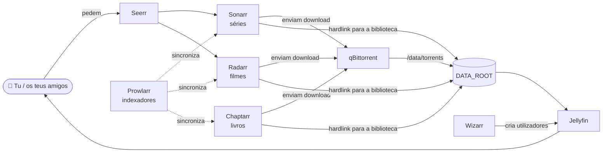

<div align="center">

# 🎬 Jellyfin + *arr Stack

**O teu centro multimédia em casa: séries, filmes, livros e audiolivros, tudo automático e com um único `docker compose up`.**


🌍 **Idioma / Language**

[ Español](README.md) · [ English](README.en.md) · [ Français](README.fr.md) · [ Italiano](README.it.md) · ** Português** · [ Deutsch](README.de.md)

</div>

---

## 🤔 Para que serve isto?

Imagina ter **o teu próprio centro multimédia** em casa: como a Netflix, a Audible e o Kindle juntos, mas sem mensalidades e com tudo o que quiseres ver, ler ou ouvir.

É isso este stack: um conjunto de aplicações que trabalham em conjunto para que só tenhas de **escolher o que queres ver, ler ou ouvir**. Elas tratam do resto:

- 🔎 **Procuram** o que pedes.
- ⬇️ **Descarregam-no** e avisam-te.
- 🗂️ **Organizam-no** em pastas com capa e sinopse.
- 📺 **Põem-no no Jellyfin**, pronto a ver na TV, no telemóvel ou no computador, em casa ou fora dela.
- 🔁 **Ficam atentas**: quando sai um episódio novo da tua série, aparece sozinho, sem fazeres nada.

**Um exemplo:** no telemóvel, pedes *"a nova temporada da minha série favorita"* no Seerr. O Sonarr encontra-a, o qBittorrent descarrega-a e, pouco depois, já está no Jellyfin com a sua capa. E todas as semanas, quando sair um episódio novo, aparecerá sozinho.

**É para mim?** Se tens um NAS ou um computador sempre ligado e te apetece montar o teu próprio centro multimédia, sim. Não precisas de ser especialista: este guia vai passo a passo.

---

## 📚 Índice

1. [O que inclui](#-o-que-inclui)
2. [Como tudo se encaixa](#-como-tudo-se-encaixa)
3. [Requisitos](#-requisitos)
4. [Passo 1 · Descarregar o repositório](#passo-1--descarregar-o-repositório)
5. [Passo 2 · Configurar o `.env`](#passo-2--configurar-o-env)
6. [Passo 3 · Criar pastas e arrancar](#passo-3--criar-pastas-e-arrancar)
7. [Passo 4 · qBittorrent](#passo-4--qbittorrent)
8. [Passo 5 · Prowlarr (indexadores)](#passo-5--prowlarr-indexadores)
9. [Passo 6 · Sonarr e Radarr](#passo-6--sonarr-e-radarr)
10. [Passo 7 · Chaptarr (livros e audiolivros)](#passo-7--chaptarr-livros-e-audiolivros)
11. [Passo 8 · Jellyfin](#passo-8--jellyfin)
12. [Passo 9 · Seerr (pedidos)](#passo-9--seerr-pedidos)
13. [Passo 10 · Wizarr (convites)](#passo-10--wizarr-convites)
14. [Manutenção](#-manutenção)
15. [Problemas frequentes](#-problemas-frequentes)

---

## 📦 O que inclui

| App | Para que serve | Porta |
|---|---|---|
| **[Jellyfin](https://jellyfin.org)** | O servidor multimédia: onde vês tudo, na TV, no telemóvel ou no navegador | `8096` |
| **[qBittorrent](https://www.qbittorrent.org)** | Cliente de downloads | `8085` |
| **[Prowlarr](https://prowlarr.com)** | Gere os indexadores num só sítio e distribui-os pelas restantes apps | `9696` |
| **[Sonarr](https://sonarr.tv)** | Séries: vigia episódios novos, descarrega-os e organiza-os | `8989` |
| **[Radarr](https://radarr.video)** | O mesmo que o Sonarr, mas para filmes | `7878` |
| **[Chaptarr](https://hub.docker.com/r/chaptarr/chaptarr)** | Livros e audiolivros (substituto do Readarr, em beta), com Postgres | `8789` |
| **[Seerr](https://github.com/seerr-team/seerr)** | Web catita para ti e para os teus amigos pedirem séries e filmes | `5055` |
| **[Wizarr](https://github.com/wizarrrr/wizarr)** | Links de convite para criar utilizadores do Jellyfin | `5690` |

---

## 🧭 Como tudo se encaixa



**A chave do desenho:** todas as apps veem a mesma pasta como `/data`. Assim, quando um download termina, o Sonarr/Radarr/Chaptarr criam um **hardlink** na biblioteca: o ficheiro aparece em dois sítios, **ocupa o espaço uma só vez** e o qBittorrent pode continuar a partilhá-lo sem que tenhas de mover nada.

```text
DATA_ROOT/                 (en los contenedores: /data)
├── torrents/              ← o qBittorrent descarrega aqui
│   ├── series/
│   ├── peliculas/
│   ├── libros/
│   └── audiolibros/
├── Series/                ← biblioteca do Sonarr
├── Peliculas/             ← biblioteca do Radarr
├── Libros/                ← biblioteca do Chaptarr (ebooks)
└── Audiolibros/           ← biblioteca do Chaptarr (audiolivros)
```

> [!IMPORTANT]
> `torrents/` e as bibliotecas têm de estar **no mesmo volume/disco**. Os hardlinks não funcionam entre discos diferentes: se os separares, cada ficheiro ocupará o dobro.

---

## ✅ Requisitos

- Um computador Linux ou um NAS (Synology, Unraid, TrueNAS…) com **Docker** e **Docker Compose v2**.
  - No Synology: instala o **Container Manager** a partir do Centro de Pacotes.
- Acesso por **SSH** (ou um terminal).
- Opcional: CPU Intel com gráficos integrados (Quick Sync) ou AMD para transcodificar por hardware no Jellyfin.
- Recomendado: **4 GB de RAM** ou mais. O Chaptarr com Postgres consome bastante durante a primeira análise.

Verifica que o Docker funciona:

```bash
docker compose version
```

---

## Passo 1 · Descarregar o repositório

```bash
git clone https://github.com/Luprintech/jellyfin-arr-stack.git
cd jellyfin-arr-stack
```

## Passo 2 · Configurar o `.env`

```bash
cp .env.example .env
nano .env
```

O mínimo que tens de alterar:

| Variável | O que pôr | Como descobrir |
|---|---|---|
| `PUID` / `PGID` | O utilizador dono dos teus ficheiros multimédia | `id teu_utilizador` |
| `TZ` | O teu fuso horário | p. ex. `Europe/Lisbon`, `Europe/Madrid` |
| `CONFIG_ROOT` | Onde guardar as configurações | p. ex. `/volume1/docker/media-stack/config` |
| `DATA_ROOT` | A pasta única de multimédia e downloads | p. ex. `/volume1/media` |
| `RENDER_GID` | Grupo da placa gráfica (só para a aceleração por hardware) | `stat -c '%g' /dev/dri/renderD128` |
| `CHAPTARR_DB_PASSWORD` | Palavra-passe do Postgres | `openssl rand -hex 24` |

> [!TIP]
> **No Synology**, o utilizador normal costuma ter um `PUID` à volta de `1026` e o grupo `users` é o `PGID=100`. O grupo da placa gráfica chama-se `videodriver`.

## Passo 3 · Criar pastas e arrancar

```bash
chmod +x scripts/setup.sh
./scripts/setup.sh
docker compose up -d
```

O script só **cria** as pastas que faltam; não apaga nem sobrescreve nada. Verifica que está tudo a funcionar:

```bash
docker compose ps
```

Todos os serviços deviam aparecer como `running` (o Seerr e o chaptarr-db como `healthy`).

Todos os contentores são criados dentro de **um único projeto chamado `jellyfin-arr-stack`**, por isso vais vê-los agrupados no Portainer, no Container Manager ou com `docker compose ls`.

> [!TIP]
> **Preferes fazê-lo pela interface do Synology?** Executa primeiro `./scripts/setup.sh` por SSH e depois vai a **Container Manager → Projeto → Criar**:
> 1. Nome do projeto: `jellyfin-arr-stack`.
> 2. Caminho: a pasta onde clonaste o repo (a que tem o `docker-compose.yml` e o `.env`).
> 3. Origem: *Usar o docker-compose.yml existente* → **Seguinte** → **Concluído**.
>
> A partir daí podes iniciar, parar, atualizar e ver os logs de todo o stack com um clique.

> [!NOTE]
> A partir daqui, substitui `IP-DO-SERVIDOR` pelo IP do teu computador, por exemplo `192.168.1.10`.

---

## Passo 4 · qBittorrent

Abre `http://IP-DO-SERVIDOR:8085`.

1. **Palavra-passe inicial:** o utilizador é `admin` e a palavra-passe temporária aparece no log:
   ```bash
   docker logs qbittorrent 2>&1 | grep -i password
   ```
   Muda-a logo que entrares em **Tools → Options → Web UI**.
2. **Downloads** → *Default Save Path*: `/data/torrents`.
3. **Categories** (clique direito em *Categories*, no painel esquerdo → *Add category*):

   | Categoria | Caminho |
   |---|---|
   | `series` | `/data/torrents/series` |
   | `peliculas` | `/data/torrents/peliculas` |
   | `libros` | `/data/torrents/libros` |
   | `audiolibros` | `/data/torrents/audiolibros` |

4. **Connection** → a porta de escuta tem de coincidir com `QBIT_TORRENT_PORT` (por defeito `51413`). Abre-a no teu router para teres melhor velocidade.

> [!WARNING]
> Nunca movas à mão ficheiros que o qBittorrent esteja a partilhar: o torrent ficaria estragado. Se precisares de os mudar de sítio, usa no qBittorrent *clique direito → Set location*.

## Passo 5 · Prowlarr (indexadores)

Abre `http://IP-DO-SERVIDOR:9696` e cria o teu utilizador.

O Prowlarr é a **agenda de indexadores**: adicionas-os aqui uma só vez e ele passa-os ao Sonarr, ao Radarr e ao Chaptarr. Um indexador é um site ou um tracker onde se procuram torrents.

> [!IMPORTANT]
> Este repositório não traz indexadores configurados nem recomenda nenhum. Tu decides quais usar e és o responsável pelo que descarregas. Respeita as leis do teu país e as regras de cada site.

### 5.1 · Ligar o qBittorrent

**Settings → Download Clients → + → qBittorrent:**
- Host: `qbittorrent` · Port: `8085` · utilizador e palavra-passe do qBittorrent.

### 5.2 · Adicionar indexadores públicos

Os públicos não precisam de conta.

1. **Indexers → Add Indexer.**
2. Filtra por **Privacy: Public**, **Protocol: torrent** e o **idioma** que te interessar.
3. Escolhe um, confirma as categorias e carrega em **Test** e depois em **Save**.

**Exemplo: Internet Archive (archive.org).** É uma biblioteca digital sem fins lucrativos, com milhares de livros, audiolivros, filmes clássicos e música de **domínio público ou com licença livre**. Procura-o como *Internet Archive* em *Add Indexer*.

> [!TIP]
> Se o Internet Archive oficial te der erro 403 ao testá-lo, usa a versão **Internet Archive (custom)** que este repositório traz (ver 5.3). É a mesma, mas identifica-se como um navegador normal e o archive.org não a bloqueia.

### 5.3 · Indexadores próprios (definições *custom*)

O Prowlarr permite adicionar indexadores que não vêm de origem, ou arranjar um que falhe, com um ficheiro YAML (formato *Cardigann*).

1. Copia o `.yml` para `CONFIG_ROOT/prowlarr/Definitions/Custom/`.
2. Reinicia o Prowlarr: `docker restart prowlarr`.
3. Em **Add Indexer** vai aparecer com o nome que o ficheiro tiver, normalmente com *(custom)* no fim.

Este repositório traz [`prowlarr/Custom/internetarchive-custom.yml`](prowlarr/Custom/internetarchive-custom.yml), e o `scripts/setup.sh` já o copia para o sítio certo.

> [!NOTE]
> O Prowlarr guarda as definições em cache. **Sempre que editares um `.yml`, reinicia o Prowlarr** ou ele continua a usar a versão anterior.

### 5.4 · Adicionar trackers privados

Os trackers privados precisam de conta, normalmente por convite. Em troca, costumam ter melhor qualidade, mais velocidade e conteúdo mais bem organizado.

1. **Indexers → Add Indexer** → filtra por **Privacy: Private** e procura o teu tracker.
2. Preenche o que ele pedir. Depende do tracker:

   | O que pede | Onde o encontras |
   |---|---|
   | **API key** (indexadores que acabam em *(API)*) | No teu perfil do tracker, em *Segurança*, *API* ou *Definições* |
   | **Utilizador e palavra-passe** | Os da tua conta |
   | **Cookie** | No navegador, com a sessão iniciada: *F12 → Application/Storage → Cookies* |
   | **Passkey / RSS key** | No teu perfil, normalmente junto às ligações RSS |

3. Carrega em **Test** e depois em **Save**.

**Cumpre as regras de rácio** ou expulsam-te. Quase todos pedem para partilhares cada torrent durante um tempo mínimo ou até atingires um rácio:
- Na configuração de cada indexador do Prowlarr preenche **Seed Ratio** e **Seed Time** com o mínimo do teu tracker. O Prowlarr passa-os ao Sonarr, ao Radarr e ao Chaptarr.
- Não apagues torrents do qBittorrent antes de cumprires esse mínimo.
- No Sonarr e no Radarr deixa desativado **Remove Completed** no cliente de descargas se o teu tracker exigir partilhar durante muito tempo.

> [!CAUTION]
> A tua API key, a tua passkey e os teus cookies são como a tua palavra-passe. **Não as partilhes nem as publiques** (nem em capturas de ecrã, nem em issues, nem em repositórios). Se se perderem, gera-as de novo a partir do teu perfil do tracker.

### 5.5 · Prioridade, categorias e perfis

- **Priority** (1–50): quanto **mais baixo**, mais preferência. Põe os teus trackers privados com um número baixo (p. ex. `10`) e os públicos mais alto (p. ex. `25`–`40`), para serem usados só como reserva.
- **Categorias:** decidem a que app chega cada indexador. *Movies* vai para o Radarr, *TV* para o Sonarr, e *Books/Audio* para o Chaptarr. Se um indexador não aparecer numa app, revê as categorias dele.
- **Sync Profile:** com *Standard* o indexador é usado para tudo (RSS, pesquisa automática e manual). Se algum te der demasiados resultados maus, cria em *Settings → Apps → Sync Profiles* um perfil só para pesquisa manual.
- **Tags:** se quiseres que um indexador chegue só a uma app, põe-lhe uma etiqueta e põe a mesma nessa app, dentro de *Settings → Apps*.

### 5.6 · Sites com Cloudflare: FlareSolverr (opcional)

Alguns sites públicos têm uma proteção da Cloudflare que o Prowlarr não consegue passar sozinho, e vais ver erros como *"blocked by CloudFlare Protection"*. Para isso existe o **FlareSolverr**. Adiciona-o ao `docker-compose.yml`:

```yaml
  flaresolverr:
    image: ghcr.io/flaresolverr/flaresolverr:latest
    container_name: flaresolverr
    environment:
      TZ: ${TZ}
    restart: unless-stopped
```

Arranca-o com `docker compose up -d` e depois:
1. **Settings → Indexers → + → FlareSolverr** · Host: `http://flaresolverr:8191` · Tags: `flaresolverr`.
2. Edita o indexador que falhava e põe-lhe a tag `flaresolverr`.

### 5.7 · Testar e ligar as apps

- **Search** (menu da esquerda): procura um título para confirmar que os teus indexadores respondem.
- **Settings → Apps:** aqui vais ligar o Sonarr, o Radarr e o Chaptarr nos passos seguintes, para que recebam os indexadores automaticamente.

> [!TIP]
> Dentro do Docker, as apps veem-se umas às outras **pelo nome do contentor** (`sonarr`, `radarr`, `qbittorrent`…). Não uses `localhost` nem o IP do servidor para as ligar entre si.

## Passo 6 · Sonarr e Radarr

Os dois configuram-se da mesma maneira. O Sonarr está em `:8989` e o Radarr em `:7878`.

1. Cria o teu utilizador ao entrares pela primeira vez.
2. **Settings → Media Management:**
   - Ativa **Show Advanced** (em cima).
   - ✅ *Use Hardlinks instead of Copy*.
   - **Root Folders → Add:** `/data/Series` (Sonarr) ou `/data/Peliculas` (Radarr).
3. **Settings → Download Clients → + → qBittorrent:**
   - Host `qbittorrent`, Port `8085`, o teu utilizador e palavra-passe.
   - Category: `series` (Sonarr) ou `peliculas` (Radarr).
4. **Settings → General:** copia a **API Key**.
5. No **Prowlarr → Settings → Apps → +**, escolhe o Sonarr (ou o Radarr):
   - Prowlarr Server: `http://prowlarr:9696`
   - Sonarr Server: `http://sonarr:8989` (ou `http://radarr:7878`)
   - API Key: a que acabaste de copiar.
6. Carrega em **Sync App Indexers** no Prowlarr. Em poucos segundos vais ver os indexadores em *Settings → Indexers* do Sonarr/Radarr.

> [!TIP]
> Em **Settings → Profiles** podes escolher a qualidade (1080p, 4K…), e em **Settings → Metadata/General**, o idioma dos títulos.

## Passo 7 · Chaptarr (livros e audiolivros)

Abre `http://IP-DO-SERVIDOR:8789`.

1. **Root Folders:** adiciona duas:
   - `/data/Libros` → tipo **ebook**
   - `/data/Audiolibros` → tipo **audiobook**
2. **Media Management:** ✅ *Use Hardlinks*.
3. **Download Clients → qBittorrent:** igual ao Sonarr, com as categorias `libros` e `audiolibros`.
4. **Prowlarr → Apps → +:** escolhe o tipo **Readarr** e põe `http://chaptarr:8789` com a API key do Chaptarr.
5. **Autores:** adiciona os que queiras seguir e ativa *Monitor*. O Chaptarr avisa-te das novidades deles.

> [!NOTE]
> Se já tens uma biblioteca grande, a **primeira análise pode demorar horas** e deixar o CPU a 100%. Por isso o `chaptarr` e o `chaptarr-db` levam `cpu_shares: 128`: cedem o CPU ao Jellyfin e ao qBittorrent. Deixa-o acabar.

## Passo 8 · Jellyfin

Abre `http://IP-DO-SERVIDOR:8096` e segue o assistente.

1. Cria o utilizador administrador.
2. **Adicionar bibliotecas.** Atenção: dentro do Jellyfin, o teu `DATA_ROOT` chama-se `/media`:

   | Biblioteca | Tipo | Pasta |
   |---|---|---|
   | Séries | Programas de TV | `/media/Series` |
   | Filmes | Filmes | `/media/Peliculas` |
   | Livros | Livros | `/media/Libros` |
   | Audiolivros | Livros | `/media/Audiolibros` |

   ⚠️ **Não** adiciones `/media/torrents`: verias tudo duplicado.
3. Idioma dos metadados: *Português* · País: *Portugal*.
4. **Aceleração por hardware** (Painel de controlo → Reprodução → Transcodificação):
   - Intel: escolhe **VAAPI** (ou *Intel QuickSync* se o teu kernel for moderno) com o dispositivo `/dev/dri/renderD128`.
   - Ativa a descodificação para H264, HEVC e VP9, e a codificação por hardware.

> [!TIP]
> **Synology com kernel 4.4:** o QSV costuma falhar com o erro `-22`. Usa **VAAPI**: funciona bem e transcodifica muitíssimo mais depressa do que o CPU.

**Recomendado em equipamentos modestos** (2 núcleos):
- Agenda a *análise da biblioteca* para a madrugada (Painel de controlo → Tarefas agendadas).
- Desativa a *monitorização em tempo real* nas bibliotecas muito grandes (livros).
- Se usas o plugin Intro Skipper, define `MaxParallelism = 1`.

**Para que o Sonarr/Radarr avisem o Jellyfin** quando houver algo novo:
*Settings → Connect → + → Emby / Jellyfin* · Host `jellyfin` · Port `8096` · API key do Jellyfin (*Painel de controlo → Chaves de API*).

## Passo 9 · Seerr (pedidos)

Abre `http://IP-DO-SERVIDOR:5055`.

1. Escolhe **Jellyfin** e inicia sessão com a tua conta de administrador do Jellyfin:
   - URL: `http://jellyfin:8096`
2. Sincroniza as bibliotecas.
3. **Services:** adiciona o Sonarr (`sonarr`, porta `8989`) e o Radarr (`radarr`, porta `7878`) com as suas API keys, e escolhe o perfil de qualidade e a pasta raiz.

A partir daqui, qualquer pessoa com utilizador do Jellyfin pode pedir séries e filmes no Seerr, e são descarregados sozinhos.

## Passo 10 · Wizarr (convites)

Abre `http://IP-DO-SERVIDOR:5690`.

1. Cria a conta de administrador.
2. Liga o Jellyfin: `http://jellyfin:8096` + API key.
3. Gera um link de convite e partilha-o: o teu amigo cria o utilizador sozinho e, além disso, o Wizarr mostra-lhe que apps instalar.

> Para convidar pessoas de fora da tua casa vais precisar de expor o Wizarr, o Seerr e o Jellyfin com um proxy inverso (Nginx Proxy Manager, Caddy, Traefik…) e HTTPS. Põe o teu domínio público em `WIZARR_APP_URL`.

---

## 🔧 Manutenção

**Atualizar todas as apps:**
```bash
docker compose pull
docker compose up -d
docker image prune -f
```

**Ver os logs de uma app:**
```bash
docker compose logs -f sonarr
```

**Cópia de segurança:** guarda a pasta `CONFIG_ROOT` completa e o teu `.env`. Com isso consegues reconstruir tudo noutra máquina. O Sonarr, o Radarr e o Prowlarr também fazem cópias automáticas em *System → Backup*.

> [!CAUTION]
> Faz a cópia do `chaptarr-db` com o contentor **parado**, ou usa `pg_dumpall`. Copiar a quente a pasta de dados do Postgres pode deixar a cópia corrompida.

---

## 🩺 Problemas frequentes

<details>
<summary><b>O Sonarr/Radarr copiam os ficheiros em vez de fazerem hardlink (o disco enche o dobro)</b></summary>

- `torrents/` e a biblioteca estão em discos ou volumes diferentes. Têm de estar sob o mesmo `DATA_ROOT`.
- Alguma app monta caminhos diferentes (por exemplo `/downloads` e `/tv`). Todas têm de usar `/data`.
- Verifica um ficheiro: `ls -li` e confirma que o número de ligações (a coluna a seguir às permissões) é `2`.
</details>

<details>
<summary><b>"Permission denied" ao importar ou ao escrever</b></summary>

`PUID`/`PGID` não coincidem com o dono de `DATA_ROOT`. Confirma com `ls -ln` na pasta e ajusta o `.env`.
</details>

<details>
<summary><b>O Seerr não arranca ou reinicia-se em ciclo</b></summary>

A pasta de configuração dele tem de pertencer ao uid 1000:
```bash
sudo chown -R 1000:1000 "$CONFIG_ROOT/seerr"
```
</details>

<details>
<summary><b>O chaptarr-db não arranca: "could not change permissions of directory"</b></summary>

A pasta `chaptarr-db/data` tem de ser de `PUID:PGID` e estar vazia no primeiro arranque. O script `setup.sh` deixa-a preparada.
</details>

<details>
<summary><b>O Jellyfin não transcodifica por hardware</b></summary>

- Verifica que existe `/dev/dri/renderD128` no host.
- `RENDER_GID` tem de ser o grupo dono desse dispositivo (`stat -c '%g' /dev/dri/renderD128`).
- Experimenta VAAPI em vez de QSV.
</details>

<details>
<summary><b>Muitos processos "zombie" no sistema</b></summary>

Acontece com contentores que lançam subprocessos (navegadores headless, scripts…) sem um init que os recolha. Acrescenta `init: true` a esse serviço no compose.
</details>

<details>
<summary><b>O CPU está a 100% o tempo todo</b></summary>

O normal é ser a primeira análise do Chaptarr ou a tarefa de segmentos ou miniaturas do Jellyfin. Descobre quem é com:
```bash
docker stats --no-stream
```
E espera que termine, ou baixa a prioridade dele com `cpu_shares`.
</details>

---

<div align="center">

Feito com ☕ e muitos `docker compose logs`. Se te foi útil, deixa uma ⭐.

</div>
